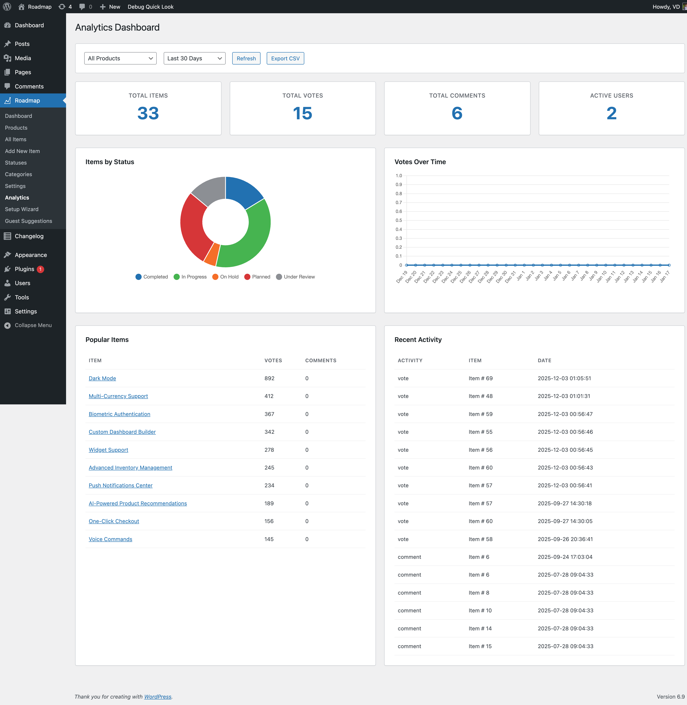

# Analytics Dashboard

> **Pro Feature** - This feature requires the [Product Roadmap Pro](https://wbcomdesigns.com/downloads/product-roadmap-pro/) addon.

Track votes, engagement, and user activity to make data-driven product decisions.

---

## Accessing Analytics

1. Install and activate the Pro addon
2. Go to **Roadmap > Analytics**
3. View your dashboard

---

## Dashboard Overview

The analytics dashboard shows key metrics at a glance.

### Summary Cards

| Metric | What It Measures |
|--------|------------------|
| Total Items | All published roadmap items |
| Total Votes | Sum of all votes across items |
| Total Comments | Discussion activity |
| Completion Rate | Percentage of items marked complete |

### Quick Insights

- **Most Voted Item** - Your top requested feature
- **Recent Activity** - Latest votes and comments
- **Trending** - Items gaining traction recently

---

## Votes Over Time

A chart showing voting patterns across your roadmap.

### What You Can Learn

- **Spike detection** - When did engagement increase?
- **Campaign tracking** - Did that email blast drive votes?
- **Seasonal patterns** - Are certain times more active?

### Chart Options

| View | Shows |
|------|-------|
| Last 7 days | Daily breakdown |
| Last 30 days | Weekly patterns |
| Last 90 days | Monthly trends |
| This year | Yearly overview |

### Using the Data

High voting days often correlate with:
- Product announcements
- Email campaigns
- Social media mentions
- Feature releases

Track these to understand what drives engagement.

---

## Popular Items

Ranked list of your most-voted features.

### Columns Shown

| Column | Description |
|--------|-------------|
| Rank | Position by vote count |
| Title | Item name (linked) |
| Status | Current workflow stage |
| Votes | Total vote count |
| Trend | Vote change recently |

### Filtering Popular Items

Filter the list by:
- **Status** - Show only planned items
- **Time period** - Votes in last 30 days only
- **Product** - Specific product's items (with multi-product)

### Making Decisions

Use popular items to:
- Prioritize your backlog
- Validate product direction
- Communicate with stakeholders
- Plan sprint content

---

## Activity Feed

Real-time stream of engagement.

### Events Tracked

| Event | What Happened |
|-------|---------------|
| Vote | User voted on an item |
| Comment | User left feedback |
| Suggestion | User submitted an idea |
| Status Change | Item moved to new status |

### Feed Details

Each entry shows:
- Action type
- Item affected
- User (if logged in)
- Timestamp
- Link to item

### Using the Feed

- Spot engaged users who vote frequently
- See which items attract discussion
- Identify voting patterns (same user, same time)
- Monitor for spam or abuse

---

## Item-Level Analytics

Each roadmap item has its own analytics.

### View Item Analytics

1. Edit any roadmap item
2. Look for the "Analytics" meta box
3. See item-specific metrics

### Item Metrics

| Metric | Description |
|--------|-------------|
| Total Votes | Votes for this item |
| Vote History | When votes were cast |
| Comments | Discussion activity |
| Views | Page visits (if tracked) |

---

## Exporting Analytics

Download your data for further analysis.

### Export to CSV

1. Go to **Roadmap > Analytics**
2. Click **Export Data**
3. Choose date range
4. Select metrics to include
5. Download CSV file

### Export Includes

- Item details (ID, title, status)
- Vote counts
- Comment counts
- Dates
- Categories/tags

### Use Cases

- Board presentations
- Stakeholder reports
- Trend analysis in Excel
- Backup for records

---

## Pro Performance Improvements

### v1.3.1 Optimizations

The latest version includes significant analytics performance improvements:

**Cached Dashboard Stats**
- Overview metrics cached for 5 minutes
- Reduces database queries on dashboard load
- Faster page rendering

**Optimized Votes Chart**
- Fixed N+1 query issue
- Batch loading of vote data
- Smoother chart rendering

**Result:** Analytics dashboard loads up to 3x faster on sites with large datasets.

---

## Multi-Product Analytics

> Requires multi-product feature enabled.

### Product-Specific Dashboard

View analytics for each product separately:

1. Go to **Roadmap > Analytics**
2. Use the **Product** filter dropdown
3. Select a product
4. Dashboard shows that product's metrics only

### Cross-Product Comparison

Compare engagement across products:
- Which product gets more votes?
- Where is discussion most active?
- What's the completion rate per product?

[Learn about Multi-Product →](multi-product.md)

---

## Understanding Your Data

### Healthy Roadmap Indicators

| Metric | Healthy Range | Action if Low |
|--------|--------------|---------------|
| Weekly votes | 10+ | Promote your roadmap |
| Comments per item | 2-5 | Encourage discussion |
| Completion rate | 20-40% | Publish more, close items |
| New items/month | 5-10 | Add more items |

### Red Flags

- **No votes for weeks** - Roadmap may be hidden or users don't know about it
- **Same user voting repeatedly** - Possible manipulation
- **High votes, low completion** - Users may feel unheard
- **No comments** - Discussion not encouraged

### Taking Action

| Insight | Action |
|---------|--------|
| Low engagement | Email users, add roadmap link to app |
| One item dominates | Consider prioritizing or explaining delay |
| Stale roadmap | Update statuses, add new items |
| High comment activity | Engage more, respond to feedback |

---

## Integrations

### Google Analytics

Track roadmap page views with your existing GA setup:
- Roadmap pages are regular WordPress pages
- Track shortcode page performance
- Set up goals for voting actions

### Webhooks (Coming Soon)

Get notifications when:
- Item reaches vote threshold
- New suggestion submitted
- Status changes

---

## Best Practices

### Regular Review

- Check analytics weekly
- Review popular items before sprint planning
- Share insights with your team
- Export monthly reports

### Data-Driven Prioritization

1. Sort by votes to see demand
2. Filter by status to see what's voteable
3. Check comments for context
4. Balance votes with strategic needs

### Communicating with Stakeholders

Use analytics to:
- Justify prioritization decisions
- Show user demand for features
- Demonstrate engagement trends
- Support budget requests

---

## Troubleshooting

### Analytics not showing data

- Ensure Pro addon is activated
- Check that items have votes
- Verify user permissions
- Clear caching plugins

### Charts not rendering

- Check for JavaScript conflicts
- Ensure Chart.js library is loading
- Try a different browser
- Disable other plugins temporarily

### Export not downloading

- Check browser popup blocker
- Verify file download permissions
- Try a different browser
- Check server disk space

---

## Get Pro Analytics

The Analytics Dashboard is available with Product Roadmap Pro.

**Included in Pro:**
- Real-time analytics dashboard
- Votes over time charts
- Popular items ranking
- Activity feed
- CSV export
- Per-product analytics

[Get Product Roadmap Pro →](https://wbcomdesigns.com/downloads/product-roadmap-pro/)

---

## Next Steps

| Goal | Guide |
|------|-------|
| Manage multiple products | [Multi-Product](multi-product.md) | Pro |
| Import/export data | [Import & Export](import-export.md) | Pro |
| Compare free vs pro | [Free vs Pro](free-vs-pro.md) |
