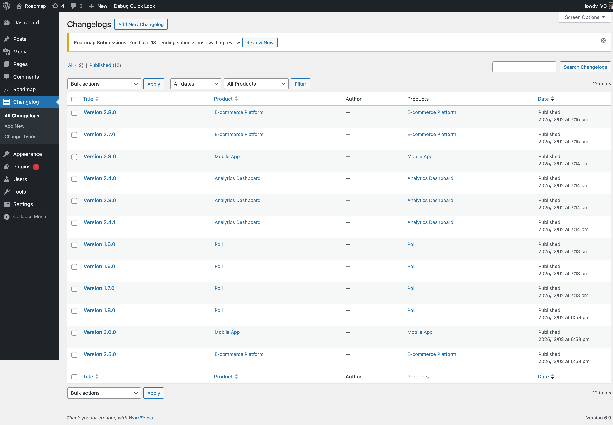
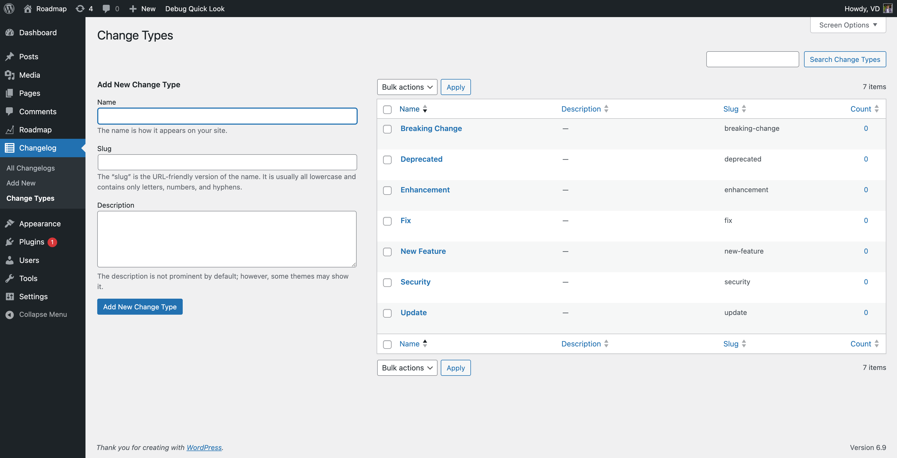
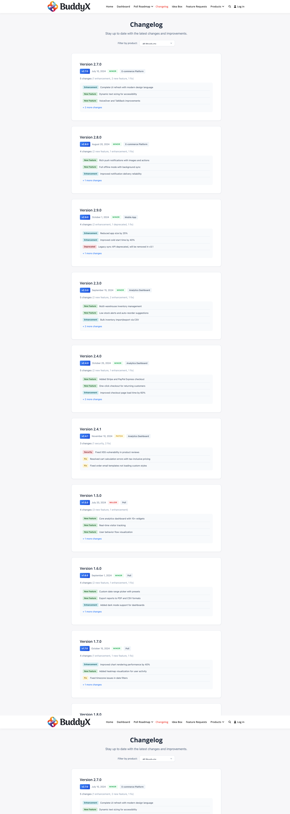

# Changelog Management

Document your releases, updates, and improvements. Keep users informed about what's new in your product.

---

## What is the Changelog?

The changelog feature lets you create release notes that:
- Document version releases
- List new features, fixes, and improvements
- Link to related roadmap items
- Show your product's evolution over time

---

## Creating Changelog Entries

### Add a New Entry



1. Go to **Roadmap > Changelog > Add New**
2. Enter a title (typically the version number)
3. Write the release notes

### Entry Fields

| Field | Purpose | Example |
|-------|---------|---------|
| Title | Version or release name | "Version 2.1.0" |
| Content | Full release notes | New features, fixes, changes |
| Release Date | When this version shipped | Custom meta field |
| Version Number | Semantic version | "2.1.0" |
| Release Type | Major, minor, patch | "Minor Release" |

### Change Types



Categorize your changelog entries by type: New Feature, Enhancement, Fix, Breaking Change, Security, Deprecated, or Update.

### Writing Good Release Notes

**Structure your content:**

```markdown
## New Features
- Added dark mode toggle in settings
- New export to PDF option for reports

## Improvements
- Faster dashboard loading (40% improvement)
- Better mobile navigation

## Bug Fixes
- Fixed login timeout on slow connections
- Resolved email notification delays

## Notes
- Requires PHP 7.4 or higher
```

**Tips:**
- Lead with the most impactful changes
- Group by type (features, fixes, improvements)
- Be specific about what changed
- Mention any breaking changes prominently

---

## Displaying Your Changelog {#display}



### Changelog Shortcode

Add to any page:

```
[roadmap_changelog]
```

### Display Options

```
[roadmap_changelog
    limit="10"
    show_date="true"
    collapsible="true"
]
```

| Parameter | Options | Default |
|-----------|---------|---------|
| `product` | a product slug | (empty) all products |
| `id` | a single entry ID | (empty) |
| `limit` | number of entries | 10 |
| `show_date` | true/false | true |
| `collapsible` | true/false | false |
| `class` | extra CSS class | (empty) |

Entries are always ordered by release date, newest first.

### Changelog Archive

Entries are also available at: `yoursite.com/roadmap-changelog/`

Each entry has its own page: `yoursite.com/roadmap-changelog/version-2-1-0/`

As of 1.7.0, the shortcode, single entry, and archive views all adopt your theme's accent color and follow your theme's light/dark toggle, with a left-aligned header. The archive keeps entries that have no release date set and orders entries by release date.

---

## Linking Items to Releases {#linking}

Connect roadmap items to changelog entries.

### Why Link Items?

- Show what features shipped in which version
- Create a paper trail from idea to release
- Help users find when features were added

### How to Link

1. Edit a roadmap item
2. Find the "Related Changelog" or "Released In" field
3. Select the relevant changelog entry
4. Update the item

The item now shows which version it shipped in.

### On the Changelog Side

1. Edit a changelog entry
2. Find "Related Items" section
3. Select roadmap items included in this release
4. Update the entry

The changelog now lists what shipped.

---

## Best Practices

### Consistency

- Use the same format for all releases
- Maintain semantic versioning (MAJOR.MINOR.PATCH)
- Always include a date
- Link to documentation for major features

### Timing

- Publish changelog when release is live
- Draft entries while building features
- Schedule posts to coincide with deployments

### Audience

- Write for users, not developers
- Explain benefits, not just technical changes
- Highlight what users asked for

---

## Pro: Multi-Product Changelogs

> **Pro Feature** - Requires the Pro addon.

### Product-Specific Changelogs

With Pro, assign changelog entries to products:

```
[roadmap_changelog product="mobile-app"]
```

Shows only entries for the mobile app product. `product` takes one slug at a time; use a separate shortcode per product to show more than one on a page.

### Admin Filtering

1. Go to **Roadmap > Changelog**
2. Use the **Product** dropdown filter
3. Select a product to see its releases
4. Bulk assign products to multiple entries

### REST API Access

Get changelogs programmatically:

```
GET /wp-json/roadmap/v1/changelog/by-product/mobile-app
```

Returns paginated results with product context.

[Learn about Multi-Product →](multi-product.md)

---

## API Integration

### REST Endpoints

**List all changelogs:**
```
GET /wp-json/roadmap/v1/changelog
```

**Get single entry:**
```
GET /wp-json/roadmap/v1/changelog/{id}
```

**Parameters:**
- `per_page` - Items per page (default: 10)
- `page` - Page number
- `orderby` - Sort field
- `order` - asc or desc

### Response Example

```json
{
  "id": 123,
  "title": "Version 2.1.0",
  "content": "<p>Release notes...</p>",
  "date": "2024-03-15T10:30:00",
  "version": "2.1.0",
  "release_type": "minor",
  "related_items": [45, 67, 89]
}
```

---

## Plugin Changelog {#plugin-changelog}

### What's New in Product Roadmap

**Version 1.7.0 (July 2026)**
- New: Theme integration - board and all views adopt the active theme's accent color
- New: Dark mode driven by your theme's own light/dark toggle
- New: Clear "Voted" button state that survives themes which restyle buttons
- New: Guest voting by IP address via a setting
- Improved: Votes and suggestions are rate-limited, and the suggestion form has a honeypot
- Improved: Status-change emails include an unsubscribe link; per-type notification toggles now take effect
- Improved: Changelog shortcode, single, and archive are theme and dark-mode aware; archive keeps undated entries and orders by release date
- Improved: Indexed votes table with bounded queries for large roadmaps; uninstall cleanup; translation-ready strings

**Version 1.3.1 (January 2026)**
- Security: Fixed vote protection improvements
- Performance: Faster API responses with batch loading
- Performance: Dashboard stats now cached

**Version 1.3.0 (December 2025)**
- New: Changelog feature for release notes
- New: Idea Box template for feedback collection
- New: Single item voting UI improvements
- Improved: Better mobile responsiveness

**Version 1.2.0**
- New: REST API endpoints
- New: Category and tag filtering
- Improved: Shortcode parameter handling

---

## Troubleshooting

### Changelog not appearing

- Verify entries are published (not drafts)
- Check shortcode syntax: `[roadmap_changelog]`
- Clear caching plugins

### Dates showing incorrectly

- Check WordPress timezone settings
- Verify date format in Settings > General
- Ensure release date field is populated

### Links between items and changelog broken

- Re-save the items and changelog entries
- Check that related fields are properly selected
- Verify items haven't been trashed

---

## Next Steps

| Goal | Guide |
|------|-------|
| Display your roadmap | [Display Options](display-options.md) |
| Track engagement | [Analytics](analytics.md) | Pro |
| Manage multiple products | [Multi-Product](multi-product.md) | Pro |
