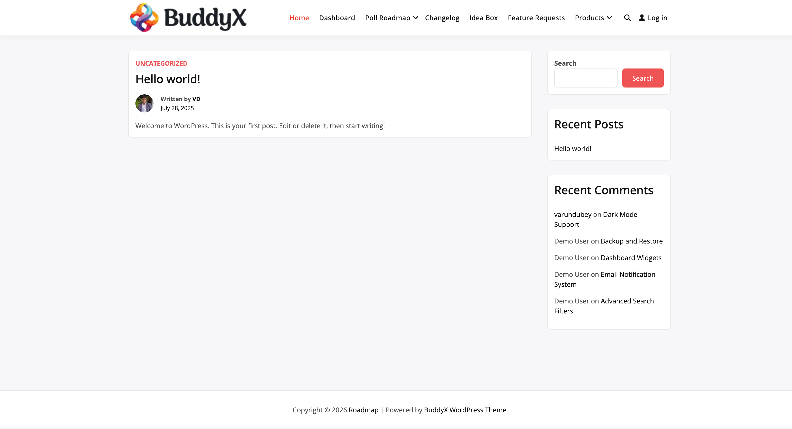

# Display Options & Shortcodes

Control how your roadmap looks and what content appears. From basic displays to advanced filtering, this guide covers all your options.

---

## Basic Shortcode

Add a roadmap to any page or post:

```
[roadmap]
```

This shows your default product using your default template, with every published item (0 = all, with a Load more button).

---

## Templates {#templates}

Choose how your roadmap is laid out.



### Minimal (Default, Free)

```
[roadmap template="minimal"]
```

A clean, single-column layout that lists your items with status, votes, and progress. This is the layout the free version ships, and it is the default when no `template` is set.

**Best for:** A simple public roadmap that reads well on any theme

**Theme and dark mode (v1.7.0):** The minimal layout - like every view - adopts your active theme's accent color (falling back to the plugin blue if your theme sets none) and follows your theme's own light/dark toggle. There is no separate dark-mode switch.

### Pro Layouts

The following layouts require the Pro addon. On free installs they fall back to the minimal layout.

```
[roadmap template="board"]      // Kanban-style columns by status (Pro)
[roadmap template="list"]       // Vertical list with badges (Pro)
[roadmap template="cards"]      // Responsive card grid (Pro)
[roadmap template="timeline"]   // Visual timeline by target date (Pro)
[roadmap template="ideabox"]    // Vote-focused idea collection (Pro)
```


### Template Comparison

| Template | Availability | Layout | Best For |
|----------|--------------|--------|----------|
| Minimal | Free | Single column | Simple public roadmap |
| Board | Pro | Columns | Project tracking |
| List | Pro | Vertical | Documentation, mobile |
| Cards | Pro | Card grid | Visual showcase |
| Timeline | Pro | Horizontal timeline | Release planning |
| Idea Box | Pro | Vertical | Feedback collection |

---

## Filtering Content {#filtering}

Show only specific items.

### Filter by Status

```
[roadmap status="in-progress"]
```

`status` takes one status slug. Visitors can still change it from the filter bar unless you add `show_filters="false"`.

| Status | Slug |
|--------|------|
| Under Review | `under-review` |
| Planned | `planned` |
| In Progress | `in-progress` |
| Complete | `complete` |

### Filter by Category

```
[roadmap category="features"]
```

`category` also takes one category slug. To show more than one status or category on the same page, use two shortcodes (one per value) or leave the parameter off and let visitors pick from the filter bar.

### Filter by Priority (Pro)

```
[roadmap priority="high"]
```

| Priority | Slug |
|----------|------|
| Low | `low` |
| Medium | `medium` |
| High | `high` |
| Critical | `critical` |

`priority` requires the Pro addon and takes one value.

### Filter by Target Date (Pro)

```
[roadmap date_from="2026-01-01" date_to="2026-03-31"]
```

Shows only items whose target date falls in that range.

### Combining Filters

Use multiple filters together:

```
[roadmap status="in-progress" priority="high" category="features"]
```

Shows only high-priority features that are in progress. `priority` requires Pro.

---

## Sorting Options

Control the order items appear with `sort`.

```
[roadmap sort="votes"]
```

| sort | Result |
|------|--------|
| (empty) | Default order |
| `votes` | Most votes first |
| `recent` | Newest first |
| `comments` | Most comments first |
| `priority` | Highest priority first |
| `title` | Alphabetical by title |

### Popular Items First

```
[roadmap sort="votes"]
```

### Most Recent First

```
[roadmap sort="recent"]
```

---

## Display Options

Control what information appears.

### Show/Hide Elements

```
[roadmap show_title="false" show_filters="false" show_search="false"]
```

| Parameter | Options | Default |
|-----------|---------|---------|
| `show_title` | true/false | true |
| `show_filters` | true/false | true |
| `show_search` | true/false | true |
| `show_voting` | (empty)/`hide` | (empty) follows Settings |
| `show_comments` | (empty)/`hide` | (empty) follows Settings |

`show_voting` and `show_comments` can only hide voting or comments on this board - they can't turn either on if it's disabled in **Roadmap > Settings**.

### Limit Items

```
[roadmap limit="10"]
```

`limit` defaults to `0`, which shows every matching item with a Load more button. Set it 1-100 to cap the number shown.

---

## Styling Your Roadmap {#styling}

### Built-in Styles

Product Roadmap includes clean, modern CSS that works with most themes.

### CSS Classes

Target these classes for custom styling:

| Element | Class |
|---------|-------|
| Container | `.roadmap-container` |
| Item card | `.roadmap-item` |
| Vote button | `.roadmap-vote-btn` |
| Status badge | `.roadmap-status` |
| Progress bar | `.roadmap-progress` |

### Custom CSS Example

Add to your theme's customizer or a custom CSS plugin:

```css
/* Change status colors */
.roadmap-status.status-planned {
    background: #3498db;
}

/* Larger vote buttons */
.roadmap-vote-btn {
    padding: 12px 24px;
    font-size: 16px;
}

/* Card shadows */
.roadmap-item {
    box-shadow: 0 2px 8px rgba(0,0,0,0.1);
}
```

### Theme Compatibility

If styles conflict with your theme:

1. Try the `[roadmap class="custom-roadmap"]` parameter
2. Use more specific CSS selectors
3. Add `!important` to override theme styles
4. Contact support if issues persist

---

## Complete Shortcode Reference

### All Parameters

```
[roadmap
    product="main"
    template="minimal"
    status="planned"
    category="features"
    priority="high"
    date_from="2026-01-01"
    date_to="2026-12-31"
    sort="votes"
    limit="20"
    show_title="true"
    show_filters="true"
    show_search="true"
    show_voting="hide"
    show_comments="hide"
    mode="view"
    allow_frontend_edit="false"
    class="my-roadmap"
]
```

Every parameter is optional. `priority`, `date_from`, and `date_to` require the Pro addon.

### Changelog Shortcode

Display your changelog:

```
[roadmap_changelog]
[roadmap_changelog limit="5"]
```

[Learn about Changelog →](changelog.md)

### Suggestion Form Shortcode

```
[roadmap_suggest_form]
```

[Learn about Suggestions →](voting-feedback.md#suggestions)

---

## Pro: Advanced Display Options

> **Pro Features** - Require the Pro addon.

### Multi-Product Roadmaps

Show items from a specific product:

```
[roadmap product="mobile-app"]
```

[Learn about Multi-Product →](multi-product.md)

### Timeline View

Lay items out on a horizontal timeline by their target date:

```
[roadmap template="timeline"]
```

Items need a target date set to appear. Combine with `date_from`/`date_to` to focus on a specific window.

[Learn about Timeline →](timeline-view.md)

### Advanced Filtering

Pro adds priority and target-date filters on top of the free `status`/`category` filters:

```
[roadmap
    priority="high"
    date_from="2026-01-01"
    date_to="2026-12-31"
]
```

### Gutenberg Block

Visual builder in the WordPress editor:

1. Add the "Product Roadmap" block
2. Configure in the sidebar panel
3. See live preview while editing
4. The block's **Shortcode** panel shows the exact shortcode for your settings

Block includes all shortcode options in a friendly interface.

### Drag & Drop

Set `mode="manage"` to let editors manage items directly from the page, including dragging items between status columns on the board layout:

```
[roadmap template="board" mode="manage"]
```

Visitors always see the read-only view regardless of `mode`.

[Learn about Drag & Drop →](drag-drop.md)

---

## Common Recipes

### "What We're Building" Page

Show in-progress work:

```
[roadmap status="in-progress" sort="priority"]
```

### "Feature Requests" Page

Collect and show user ideas:

```
[roadmap template="ideabox" status="under-review"]
```

### "Recently Shipped" Page

Show completed items:

```
[roadmap status="complete" sort="recent" limit="10"]
```

### Sidebar Widget

Compact display of top voted items:

```
[roadmap template="list" sort="votes" limit="5"]
```

### Team Internal View

High-priority items for team review:

```
[roadmap priority="high" status="planned" mode="manage"]
```

Run a second board with `status="in-progress"` for the next stage, since `status` and `priority` each take one value.

---

## Troubleshooting

### Shortcode shows as text

- Ensure the shortcode is in a text/code block, not visual editor formatting
- Check for curly quotes instead of straight quotes
- Verify the plugin is activated

### Items not appearing

- Check that items are published (not draft)
- Verify filter parameters match actual content
- Remember `status`, `category`, and `priority` each accept only one value - a comma-separated list returns an empty board

### Styles not loading

- Clear browser cache
- Check for CSS conflicts with your theme
- Verify plugin CSS isn't blocked by optimization plugins

### Not all items showing

- `limit="0"` (the default) shows everything with a Load more button - make sure visitors are clicking it
- Clear caching plugins

---

## Next Steps

| Goal | Guide |
|------|-------|
| Set up user voting | [Voting & Feedback](voting-feedback.md) |
| Document releases | [Changelog](changelog.md) |
| Track engagement | [Analytics](analytics.md) | Pro |
| Manage multiple products | [Multi-Product](multi-product.md) | Pro |
