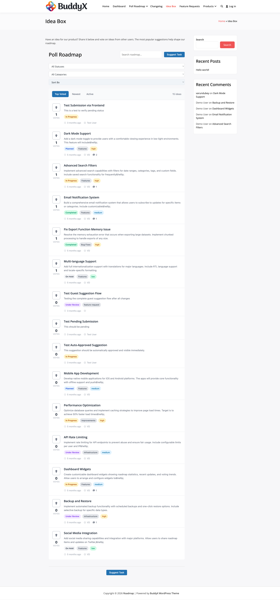

# Display Options & Shortcodes

Control how your roadmap looks and what content appears. From basic displays to advanced filtering, this guide covers all your options.

---

## Basic Shortcode

Add a roadmap to any page or post:

```
[roadmap]
```

This shows all published roadmap items using your default template.

---

## Templates {#templates}

Choose how your roadmap is laid out.


### Minimal (Default, Free)

```
[roadmap template="minimal"]
```

A clean, single-column layout that lists your items with status, votes, and progress. This is the layout the free version ships, and it is the default when no `template` is set.

**Best for:** A simple public roadmap that reads well on any theme

**Theme and dark mode (v1.7.0):** The minimal layout - like every view - adopts your active theme's accent color (falling back to the plugin blue if your theme sets none) and follows your theme's own light/dark toggle. There is no separate dark-mode switch.

### Pro Layouts

The following layouts require the Pro addon. On free installs they fall back to the minimal layout.

```
[roadmap template="board"]      // Kanban columns by status (Pro)
[roadmap template="list"]       // Vertical list with badges (Pro)
[roadmap template="cards"]      // Responsive card grid (Pro)
[roadmap template="timeline"]   // Gantt chart (Pro)
[roadmap template="ideabox"]    // Vote-focused idea collection (Pro)
```



### Template Comparison

| Template | Availability | Layout | Best For |
|----------|--------------|--------|----------|
| Minimal | Free | Single column | Simple public roadmap |
| Board | Pro | Columns | Project tracking |
| List | Pro | Vertical | Documentation, mobile |
| Cards | Pro | Card grid | Visual showcase |
| Timeline | Pro | Gantt | Release planning |
| Idea Box | Pro | Vertical | Feedback collection |

---

## Filtering Content {#filtering}

Show only specific items.

### Filter by Status

```
[roadmap status="in-progress"]
[roadmap status="planned,in-progress"]
```

| Status | Slug |
|--------|------|
| Under Review | `under-review` |
| Planned | `planned` |
| In Progress | `in-progress` |
| Complete | `complete` |

### Filter by Category

```
[roadmap category="features"]
[roadmap category="features,improvements"]
```

Use category slugs, comma-separated for multiple.

### Filter by Tag

```
[roadmap tag="mobile"]
[roadmap tag="mobile,priority"]
```

### Filter by Priority

```
[roadmap priority="high"]
[roadmap priority="high,critical"]
```

| Priority | Slug |
|----------|------|
| Low | `low` |
| Medium | `medium` |
| High | `high` |
| Critical | `critical` |

### Combining Filters

Use multiple filters together:

```
[roadmap status="in-progress" priority="high" category="features"]
```

Shows only high-priority features that are in progress.

---

## Sorting Options

Control the order items appear.

### Sort Parameters

```
[roadmap orderby="date" order="desc"]
```

| orderby | Result |
|---------|--------|
| `date` | Sort by publish date |
| `title` | Alphabetical by title |
| `votes` | Most voted first |
| `priority` | Critical → Low |
| `progress` | Completion percentage |
| `modified` | Recently updated first |

| order | Result |
|-------|--------|
| `asc` | Ascending (A-Z, oldest first) |
| `desc` | Descending (Z-A, newest first) |

### Popular Items First

```
[roadmap orderby="votes" order="desc"]
```

### Most Recent First

```
[roadmap orderby="date" order="desc"]
```

---

## Display Options

Control what information appears.

### Show/Hide Elements

```
[roadmap show_votes="true" show_progress="true" show_status="false"]
```

| Parameter | Options | Default |
|-----------|---------|---------|
| `show_votes` | true/false | true |
| `show_progress` | true/false | true |
| `show_status` | true/false | true |
| `show_priority` | true/false | false |
| `show_category` | true/false | false |
| `show_date` | true/false | false |
| `show_comments` | true/false | false |

### Limit Items

```
[roadmap limit="10"]
```

Shows only the first 10 items (after filtering and sorting).

### Pagination

```
[roadmap paginate="true" per_page="20"]
```

Adds pagination when you have many items.

---

## Styling Your Roadmap {#styling}

### Built-in Styles

Product Roadmap includes clean, modern CSS that works with most themes.

### CSS Classes

Target these classes for custom styling:

| Element | Class |
|---------|-------|
| Container | `.roadmap-container` |
| Item card | `.roadmap-item` |
| Vote button | `.roadmap-vote-btn` |
| Status badge | `.roadmap-status` |
| Progress bar | `.roadmap-progress` |

### Custom CSS Example

Add to your theme's customizer or a custom CSS plugin:

```css
/* Change status colors */
.roadmap-status.status-planned {
    background: #3498db;
}

/* Larger vote buttons */
.roadmap-vote-btn {
    padding: 12px 24px;
    font-size: 16px;
}

/* Card shadows */
.roadmap-item {
    box-shadow: 0 2px 8px rgba(0,0,0,0.1);
}
```

### Theme Compatibility

If styles conflict with your theme:

1. Try the `[roadmap class="custom-roadmap"]` parameter
2. Use more specific CSS selectors
3. Add `!important` to override theme styles
4. Contact support if issues persist

---

## Complete Shortcode Reference

### All Parameters

```
[roadmap
    template="minimal"
    status="planned,in-progress"
    category="features"
    tag="mobile"
    priority="high"
    orderby="votes"
    order="desc"
    limit="20"
    paginate="true"
    per_page="10"
    show_votes="true"
    show_progress="true"
    show_status="true"
    show_suggest="true"
    class="my-roadmap"
]
```

### Changelog Shortcode

Display your changelog:

```
[roadmap_changelog]
[roadmap_changelog limit="5"]
```

[Learn about Changelog →](changelog.md)

### Suggestion Form Shortcode

```
[roadmap_suggest_form]
```

[Learn about Suggestions →](voting-feedback.md#suggestions)

---

## Pro: Advanced Display Options

> **Pro Features** - Require the Pro addon.

### Multi-Product Roadmaps

Show items from specific products:

```
[roadmap product="mobile-app"]
[roadmap product="mobile-app,web-platform"]
```

[Learn about Multi-Product →](multi-product.md)

### Timeline View

Interactive Gantt chart display:

```
[roadmap template="timeline"]
```

Configure view modes: Day, Week, Month, Quarter, Year

[Learn about Timeline →](timeline-view.md)

### Advanced Filtering

Pro adds more filter options:

```
[roadmap
    date_from="2024-01-01"
    date_to="2024-12-31"
    assignee="5"
    min_progress="50"
    has_dependencies="true"
]
```

### Gutenberg Block

Visual builder in the WordPress editor:

1. Add the "Product Roadmap" block
2. Configure in the sidebar panel
3. See live preview while editing
4. No shortcode syntax needed

Block includes all shortcode options in a friendly interface.

### Drag & Drop

With Pro, kanban boards support drag and drop:
- Drag items between status columns
- Changes save automatically
- Permission-based (admin or allowed roles only)

[Learn about Drag & Drop →](drag-drop.md)

---

## Common Recipes

### "What We're Building" Page

Show in-progress work:

```
[roadmap status="in-progress" orderby="priority" order="desc"]
```

### "Feature Requests" Page

Collect and show user ideas:

```
[roadmap template="ideabox" status="under-review" show_suggest="true"]
```

### "Recently Shipped" Page

Show completed items:

```
[roadmap status="complete" orderby="modified" order="desc" limit="10"]
```

### Sidebar Widget

Compact display of top voted items:

```
[roadmap template="list" orderby="votes" order="desc" limit="5" show_progress="false"]
```

### Team Internal View

High-priority items for team review:

```
[roadmap priority="high,critical" status="planned,in-progress"]
```

---

## Troubleshooting

### Shortcode shows as text

- Ensure the shortcode is in a text/code block, not visual editor formatting
- Check for curly quotes instead of straight quotes
- Verify the plugin is activated

### Items not appearing

- Check that items are published (not draft)
- Verify filter parameters match actual content
- Ensure items have the specified status/category/tag

### Styles not loading

- Clear browser cache
- Check for CSS conflicts with your theme
- Verify plugin CSS isn't blocked by optimization plugins

### Pagination not working

- Ensure `paginate="true"` is set
- Check that you have more items than `per_page` value
- Clear caching plugins

---

## Next Steps

| Goal | Guide |
|------|-------|
| Set up user voting | [Voting & Feedback](voting-feedback.md) |
| Document releases | [Changelog](changelog.md) |
| Track engagement | [Analytics](analytics.md) | Pro |
| Manage multiple products | [Multi-Product](multi-product.md) | Pro |
