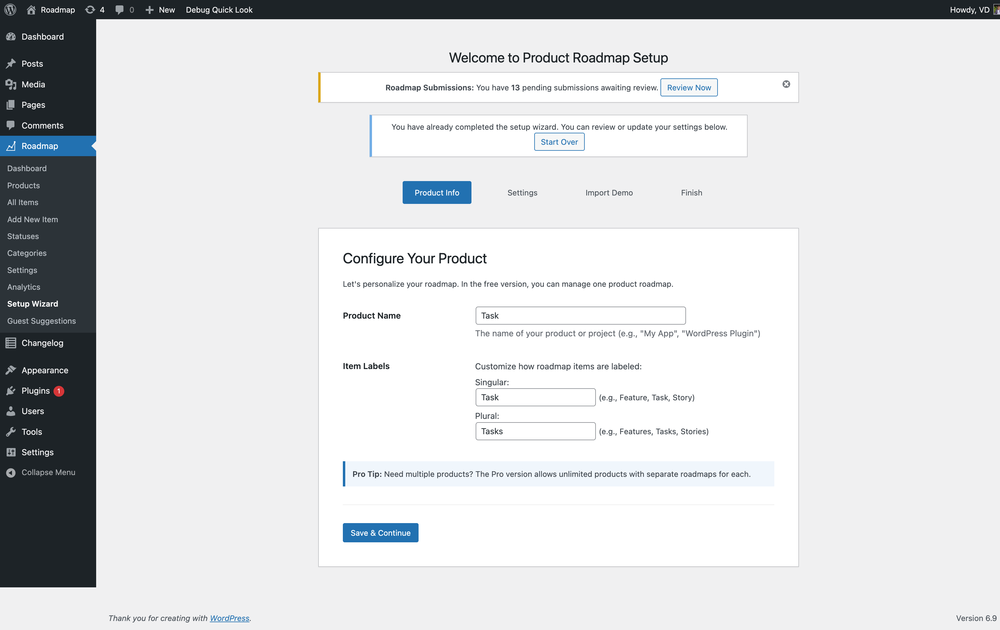
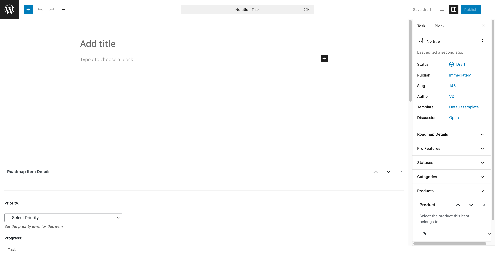
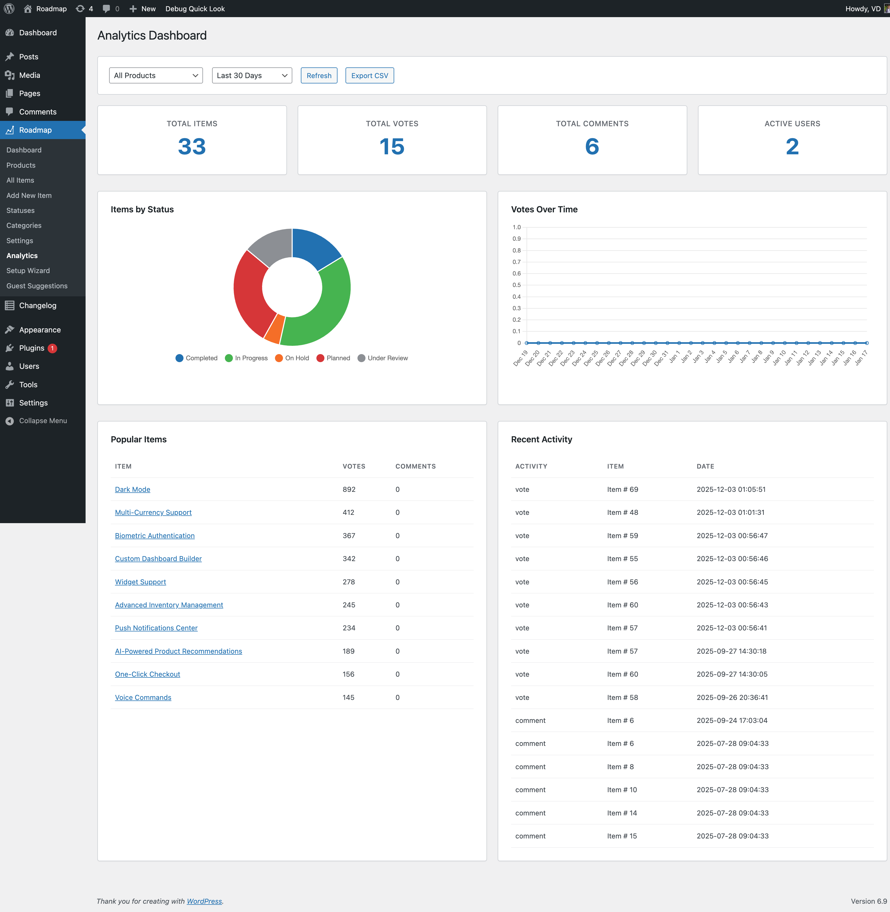

# Getting Started with Product Roadmap

Set up your first roadmap in under 10 minutes. This guide walks you through installation, initial setup, and creating your first roadmap item.

---

## Installation

### From WordPress.org

1. Go to **Plugins > Add New** in your WordPress admin
2. Search for "Product Roadmap"
3. Click **Install Now** on the plugin by Starter Starter
4. Click **Activate**

### Manual Installation

1. Download the plugin ZIP from WordPress.org
2. Go to **Plugins > Add New > Upload Plugin**
3. Choose the ZIP file and click **Install Now**
4. Click **Activate**

After activation, you'll see a new **Roadmap** menu in your WordPress admin sidebar.

---

## Setup Wizard {#setup-wizard}

When you first activate the plugin, a setup wizard helps you configure the basics.



### Step 1: Welcome

Click **Let's Get Started** to begin configuration.

### Step 2: Display Settings

Choose how your roadmap looks:

| Setting | Options | Recommendation |
|---------|---------|----------------|
| Default Template | Minimal (Board, List, Cards, Timeline, Idea Box are Pro) | Minimal for the free version |
| Items Per Page | 10-100 | 20 for balanced loading |
| Show Progress Bars | Yes/No | Yes for transparency |

### Step 3: Voting Settings

Configure how users can vote:

| Setting | Options | Recommendation |
|---------|---------|----------------|
| Allow Voting | Yes/No | Yes for engagement |
| Who Can Vote | Logged-in, Guests, Both | Both for maximum feedback |
| Vote Display | Count, None | Count to show popularity |

### Step 4: Status Configuration

Set up your workflow stages. Default statuses work for most use cases:

- **Under Review** - New ideas being considered
- **Planned** - Approved for future work
- **In Progress** - Currently being built
- **Complete** - Shipped and available

You can customize these later under **Roadmap > Settings > Statuses**.

### Step 5: Complete

Click **Finish Setup** to save your configuration.

---

## Creating Your First Item {#first-item}

Now let's add something to your roadmap.



### Step 1: Add New Item

1. Go to **Roadmap > Add New**
2. Enter a title (e.g., "Dark Mode Support")
3. Add a description explaining the feature

### Step 2: Set Item Details

In the sidebar, configure:

| Field | What to Enter |
|-------|---------------|
| Status | Choose current stage (e.g., "Planned") |
| Priority | Set importance (Low, Medium, High, Critical) |
| Progress | Enter percentage complete (0-100) |
| Category | Optional grouping (e.g., "UI", "Backend") |

### Step 3: Publish

Click **Publish** to make the item visible on your roadmap.

---

## Displaying Your Roadmap

Add the roadmap to any page or post.

### Using the Shortcode

1. Create a new page (e.g., "Our Roadmap")
2. Add this shortcode: `[roadmap]`
3. Publish the page

### Basic Shortcode Options

```
[roadmap]                           // Default display (minimal layout)
[roadmap status="planned"]          // Show only planned items
[roadmap template="list"]           // List view (Pro; free falls back to minimal)
[roadmap show_voting="hide"]        // Hide voting on this board
```

[See all shortcode options →](display-options.md)

---

## What's Next?

Now that you have a basic roadmap running, explore these topics:

| Goal | Guide |
|------|-------|
| Add more items efficiently | [Managing Items](managing-items.md) |
| Get user feedback | [Voting & Feedback](voting-feedback.md) |
| Customize the display | [Display Options](display-options.md) |
| Track releases | [Changelog](changelog.md) |

---

## Pro: Advanced Setup

> **Pro Feature** - These options require the Pro addon.

### Analytics Dashboard

After installing Pro, visit **Roadmap > Analytics** to see:
- Vote trends over time
- Most popular items
- User engagement metrics



[Learn about Analytics →](analytics.md)

### Multi-Product Roadmaps

Managing multiple products? Pro lets you create separate roadmaps:

```
[roadmap product="mobile-app"]
[roadmap product="web-platform"]
```

[Learn about Multi-Product →](multi-product.md)

### Gutenberg Block Builder

Pro includes a visual block for the WordPress editor:

1. Edit any page
2. Add the "Product Roadmap" block
3. Configure settings in the sidebar panel
4. See a live preview as you work

No shortcode syntax to remember.

[Get Pro Addon →](https://wbcomdesigns.com/downloads/product-roadmap-pro/)

---

## Troubleshooting First Setup

### Roadmap page is blank

- Check that you published at least one roadmap item
- Verify the shortcode syntax: `[roadmap]`
- Clear any caching plugins

### Voting not working

- Go to **Roadmap > Settings > Voting**
- Ensure "Allow Voting" is enabled
- Check your voting permissions setting

### Styles look broken

- Ensure your theme doesn't conflict with the plugin CSS
- Try switching to a default WordPress theme temporarily
- Check browser console for JavaScript errors

[More troubleshooting tips →](troubleshooting.md)
