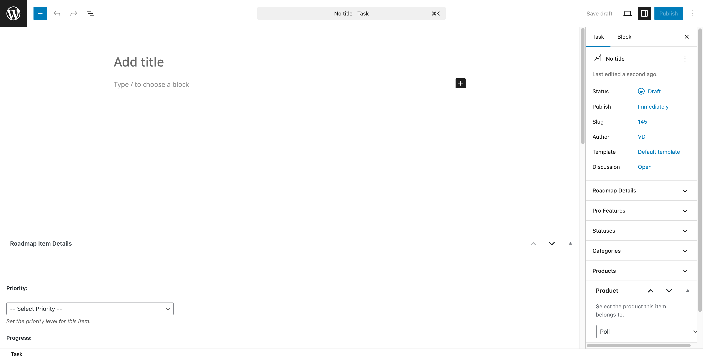
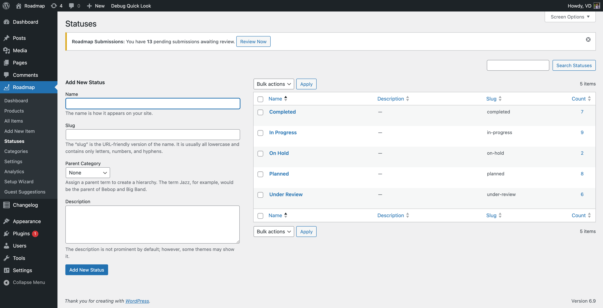
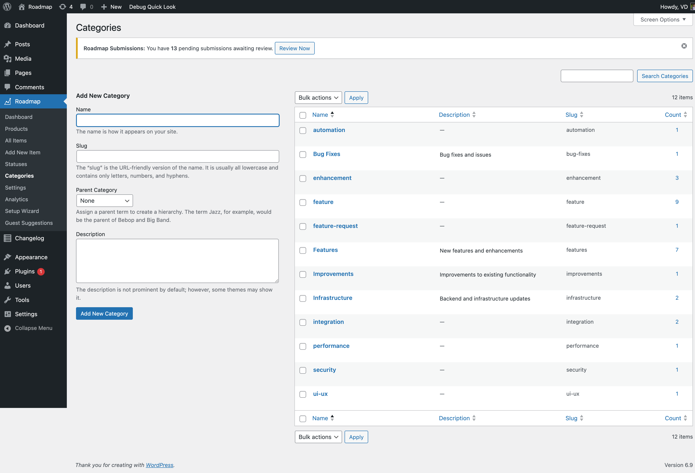
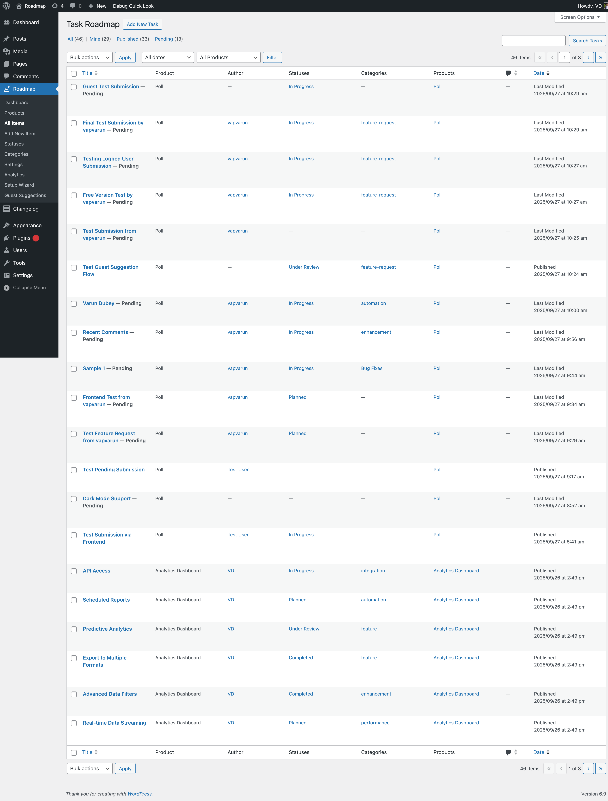

# Managing Roadmap Items

Everything you need to know about creating, editing, and organizing your roadmap items.

---

## Creating Items

### Add a New Item



1. Go to **Roadmap > Add New**
2. Enter a clear, descriptive title
3. Write a detailed description

**Title Tips:**
- Keep it concise (under 60 characters)
- Start with an action verb when possible
- Be specific: "Add dark mode toggle" vs "Dark mode"

**Description Tips:**
- Explain the problem being solved
- Describe the expected outcome
- Include any relevant context or constraints

### Item Fields Explained

| Field | Purpose | Example |
|-------|---------|---------|
| Title | Short name for the feature | "Export to PDF" |
| Description | Full details about the item | "Allow users to export their dashboard data as a PDF report..." |
| Status | Current workflow stage | In Progress |
| Priority | Importance level | High |
| Progress | Completion percentage | 65% |
| Category | Grouping for organization | "Reporting" |
| Tags | Additional labels | "mobile", "requested" |

---

## Status & Priority {#status-priority}

### Default Statuses



Product Roadmap comes with four statuses that cover most workflows:

| Status | When to Use | Color |
|--------|-------------|-------|
| Under Review | New ideas being evaluated | Gray |
| Planned | Approved for future development | Blue |
| In Progress | Currently being worked on | Yellow |
| Complete | Shipped and available | Green |

### Customizing Statuses

Need different statuses? Go to **Roadmap > Settings > Statuses** to:
- Rename existing statuses
- Add new statuses
- Change status colors
- Reorder the workflow

**Example Custom Workflow:**
- Submitted → Evaluating → Approved → Building → Testing → Shipped

### Priority Levels

Priority helps you communicate urgency:

| Priority | When to Use |
|----------|-------------|
| Low | Nice to have, no timeline pressure |
| Medium | Important but not urgent |
| High | Significant impact, schedule for soon |
| Critical | Must do immediately, blocking issue |

---

## Progress Tracking {#progress}

Show users how close a feature is to completion.

### Setting Progress

1. Edit a roadmap item
2. Find the "Progress" field in the sidebar
3. Enter a percentage (0-100)
4. Update the item

### Progress Display Options

Configure how progress appears under **Roadmap > Settings > Display**:

| Option | Result |
|--------|--------|
| Show progress bar | Visual bar showing completion |
| Show percentage | Numeric display (e.g., "65%") |
| Hide progress | No progress indicator shown |

### Progress Best Practices

- Update progress regularly (at least weekly)
- Use round numbers (25%, 50%, 75%) for simplicity
- Set to 100% only when truly complete
- Consider automating with project management integrations

---

## Organizing Items {#organization}

### Categories



Categories group related items together.

**Create a Category:**
1. Go to **Roadmap > Categories**
2. Enter a name (e.g., "User Interface")
3. Add an optional description
4. Click **Add New Category**

**Use Categories For:**
- Feature areas (UI, Backend, API)
- Product sections (Dashboard, Settings, Reports)
- Teams (Design, Engineering, Product)

### Tags

Tags add flexible, cross-cutting labels.

**Example Tags:**
- `customer-requested` - Items from user feedback
- `quick-win` - Easy to implement
- `mobile` - Related to mobile experience
- `breaking-change` - Requires migration

### Filtering by Category or Tag

Display specific groups on your roadmap:

```
[roadmap category="user-interface"]
[roadmap tag="customer-requested"]
```

---

## Bulk Editing

Manage multiple items at once.



### Quick Edit

1. Go to **Roadmap > All Items**
2. Hover over an item
3. Click **Quick Edit**
4. Change status, priority, or category
5. Click **Update**

### Bulk Actions

1. Go to **Roadmap > All Items**
2. Select multiple items using checkboxes
3. Choose an action from the **Bulk Actions** dropdown:
   - Edit (change status, category for all)
   - Move to Trash
4. Click **Apply**

---

## Pro: Advanced Item Management

> **Pro Features** - Require the Pro addon.

### Drag & Drop Status Changes

Move items between statuses by dragging:

1. Enable drag & drop in **Roadmap > Settings > Pro Features**
2. Go to your frontend roadmap
3. Click and drag any item to a new status column
4. Changes save automatically

[Learn about Drag & Drop →](drag-drop.md)

### CSV Import

Add items in bulk from a spreadsheet:

1. Go to **Roadmap > Import**
2. Download the sample CSV template
3. Fill in your items
4. Upload and import

[Learn about Import/Export →](import-export.md)

### Multi-Product Assignment

Assign items to specific products:

1. Edit any roadmap item
2. In the sidebar, find the **Product** dropdown
3. Select the appropriate product
4. Update the item

[Learn about Multi-Product →](multi-product.md)

### Dependencies

Link related items together:

1. Edit an item
2. Find the **Dependencies** section
3. Select items this depends on
4. Update to create the relationship

Dependencies show which items must be completed before others can start.

### Assignees

Track who's responsible for each item:

1. Edit an item
2. Select a user from the **Assignee** dropdown
3. Assignee avatars display on the roadmap

---

## Best Practices

### Naming Conventions

Use consistent patterns for clear communication:

| Pattern | Example |
|---------|---------|
| Action + Feature | "Add export to CSV" |
| Area: Feature | "Dashboard: Add quick filters" |
| [Type] Feature | "[Bug] Login timeout issue" |

### Status Discipline

- Move items through statuses promptly
- Don't leave items in "In Progress" indefinitely
- Archive completed items periodically
- Review "Under Review" items weekly

### Progress Updates

- Schedule regular update sessions
- Tie updates to actual milestones
- Communicate major progress changes to users
- Use 0% for items not yet started

---

## Next Steps

| Goal | Guide |
|------|-------|
| Set up user voting | [Voting & Feedback](voting-feedback.md) |
| Customize how items display | [Display Options](display-options.md) |
| Track releases | [Changelog](changelog.md) |
| Analyze engagement | [Analytics](analytics.md) | Pro |
