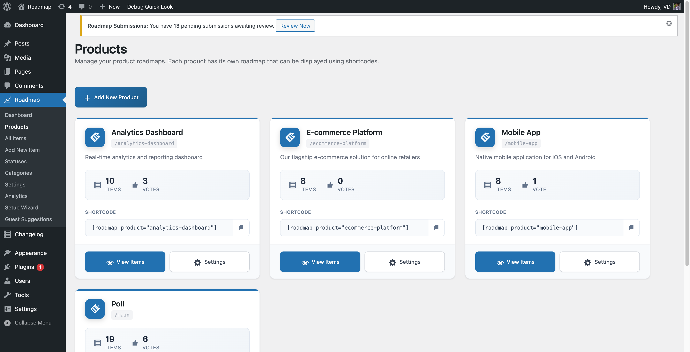

# Multi-Product Management

> **Pro Feature** - This feature requires the [Product Roadmap Pro](https://wbcomdesigns.com/downloads/product-roadmap-pro/) addon.

Manage separate roadmaps for different products, services, or projects from a single WordPress installation.

---

## Why Multi-Product?

If you build more than one product, you need separate roadmaps:

| Scenario | Solution |
|----------|----------|
| SaaS company with mobile + web apps | Separate roadmap per platform |
| Agency managing client projects | Roadmap per client |
| Multiple WordPress plugins | Roadmap per plugin |
| Product with distinct modules | Roadmap per module |

Multi-product support lets you:
- Keep roadmaps organized
- Show relevant content to each audience
- Track analytics per product
- Filter admin views by product

---

## Setting Up Products

### Enable Multi-Product

1. Go to **Roadmap > Settings > Pro Features**
2. Enable "Multi-Product Support"
3. Save changes

### Create Products



Products are managed as a WordPress taxonomy.

1. Go to **Roadmap > Products**
2. Click **Add New Product**
3. Enter:
   - **Name**: Display name (e.g., "Mobile App")
   - **Slug**: URL-friendly version (e.g., "mobile-app")
   - **Description**: Optional explanation
4. Click **Add New Product**

### Default Product

The free plugin creates a "Main" product automatically. This is the default for:
- Existing items before Pro activation
- New items if no product selected

You can rename "Main" but keep it for backwards compatibility.

---

## Assigning Items to Products

### Single Item

1. Edit any roadmap item
2. Find the **Product** dropdown in the sidebar
3. Select the appropriate product
4. Update the item

### Bulk Assignment

1. Go to **Roadmap > All Items**
2. Select multiple items with checkboxes
3. Choose **Edit** from Bulk Actions
4. Click **Apply**
5. Select a Product in the bulk edit panel
6. Click **Update**

### Default Product for New Items

Set a default under **Roadmap > Settings > Pro Features**:
- New items automatically assigned to this product
- Override when creating individual items

---

## Displaying Product Roadmaps

### Single Product

Show one product's roadmap:

```
[roadmap product="mobile-app"]
```

### Multiple Products

Show items from several products:

```
[roadmap product="mobile-app,web-platform"]
```

Comma-separated slugs display items from all listed products.

### All Products

The default shortcode shows all items regardless of product:

```
[roadmap]
```

### Product-Specific Pages

Create dedicated pages for each product:

| Page | Shortcode |
|------|-----------|
| Mobile App Roadmap | `[roadmap product="mobile-app"]` |
| Web Platform Roadmap | `[roadmap product="web-platform"]` |
| API Roadmap | `[roadmap product="api"]` |

---

## Product Changelogs

### Assigning Changelog Entries

1. Edit a changelog entry
2. Select a Product in the sidebar
3. Update the entry

### Displaying by Product

```
[roadmap_changelog product="mobile-app"]
```

Shows only releases for that product.

### Multiple Product Changelogs

```
[roadmap_changelog product="mobile-app,web-platform"]
```

Displays releases from both products.

### REST API

Get changelogs for a product programmatically:

```
GET /wp-json/roadmap/v1/changelog/by-product/mobile-app
```

Parameters:
- `page` - Page number (default: 1)
- `limit` - Items per page (default: 10)

Response includes pagination metadata.

---

## Admin Filtering

### Items List

1. Go to **Roadmap > All Items**
2. Use the **Product** dropdown filter above the list
3. Select a product
4. Click **Filter**

Now you see only items for that product.

### Changelog List

Same process:
1. Go to **Roadmap > Changelog**
2. Use the **Product** dropdown
3. Filter to see product-specific entries

### Product Column

The items list shows a **Product** column indicating which product each item belongs to.

---

## Product Analytics

### Per-Product Dashboard

1. Go to **Roadmap > Analytics**
2. Use the **Product** filter dropdown
3. Select a product
4. View analytics for that product only

### Metrics Shown

- Total items for this product
- Votes on this product's items
- Completion rate for this product
- Popular items within this product

### Cross-Product Insights

Compare products:
- Which product gets more engagement?
- Where is completion rate highest?
- What's the vote distribution?

[Learn about Analytics →](analytics.md)

---

## Shortcode Examples

### Basic Product Roadmap

```
[roadmap product="mobile-app"]
```

### Product with Specific Status

```
[roadmap product="mobile-app" status="in-progress"]
```

### Product with Voting Focus

```
[roadmap product="mobile-app" template="ideabox" show_suggest="true"]
```

### Product Sorted by Votes

```
[roadmap product="mobile-app" orderby="votes" order="desc"]
```

### Product Timeline

```
[roadmap product="mobile-app" template="timeline"]
```

### Combining Products and Filters

```
[roadmap product="mobile-app,web-platform" status="planned" priority="high"]
```

---

## Use Cases

### SaaS with Multiple Apps

**Scenario:** You run a SaaS with iOS app, Android app, and web dashboard.

**Setup:**
1. Create products: "iOS App", "Android App", "Web Dashboard"
2. Create pages for each:
   - `/roadmap/ios/` → `[roadmap product="ios-app"]`
   - `/roadmap/android/` → `[roadmap product="android-app"]`
   - `/roadmap/web/` → `[roadmap product="web-dashboard"]`
3. Link from each app to its roadmap

### Agency Client Projects

**Scenario:** You manage roadmaps for multiple clients.

**Setup:**
1. Create products for each client: "Client A", "Client B"
2. Use private pages with client access
3. Filter admin view by client when working
4. Track analytics per client

### Plugin Developer

**Scenario:** You sell multiple WordPress plugins.

**Setup:**
1. Create products matching each plugin
2. Embed relevant roadmap in each plugin's page
3. Changelog per plugin shows its updates
4. Analytics shows which plugin users engage most

---

## Migration Tips

### Existing Items

When you enable multi-product:
- All existing items remain in "Main" product
- Reassign items as needed
- Use bulk edit for efficiency

### Keeping Backwards Compatibility

If you have existing shortcodes without `product` parameter:
- They continue to show all products
- Add `product` parameter to filter
- No breaking changes for existing pages

---

## Best Practices

### Product Organization

- Use clear, consistent naming
- Match slugs to your actual product names
- Keep descriptions helpful
- Don't create too many products (hard to manage)

### Audience Consideration

- Each product's roadmap should serve its users
- Don't mix unrelated products on one page
- Consider user journey when linking roadmaps

### Maintenance

- Regularly review product assignments
- Archive old products when discontinued
- Keep changelogs product-specific
- Review analytics per product monthly

---

## Troubleshooting

### Items showing on wrong product roadmap

- Check item's product assignment
- Verify shortcode uses correct product slug
- Clear any caching plugins

### Product filter not showing

- Ensure multi-product is enabled in settings
- Check that products exist
- Verify Pro addon is active

### Bulk assignment not working

- Confirm items are selected
- Check user permissions
- Try fewer items at once

---

## Get Multi-Product Support

Multi-Product Management is available with Product Roadmap Pro.

**Included in Pro:**
- Unlimited products
- Product taxonomy management
- Shortcode filtering by product
- Admin filtering by product
- Per-product analytics
- Product-specific changelogs

[Get Product Roadmap Pro →](https://wbcomdesigns.com/downloads/product-roadmap-pro/)

---

## Next Steps

| Goal | Guide |
|------|-------|
| Track engagement | [Analytics](analytics.md) | Pro |
| Import/export data | [Import & Export](import-export.md) | Pro |
| Visual timeline | [Timeline View](timeline-view.md) | Pro |
| Compare features | [Free vs Pro](free-vs-pro.md) |
