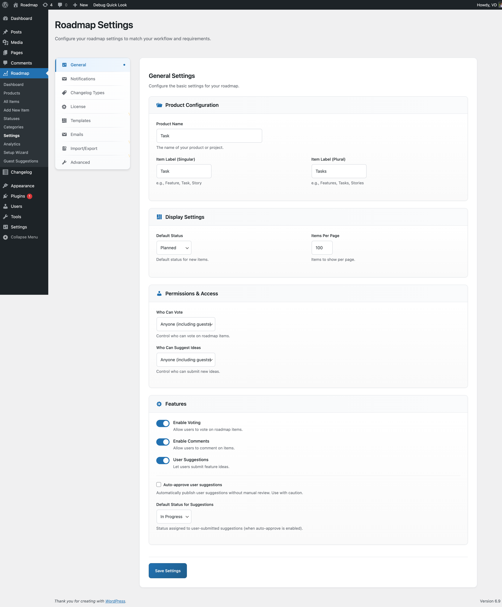
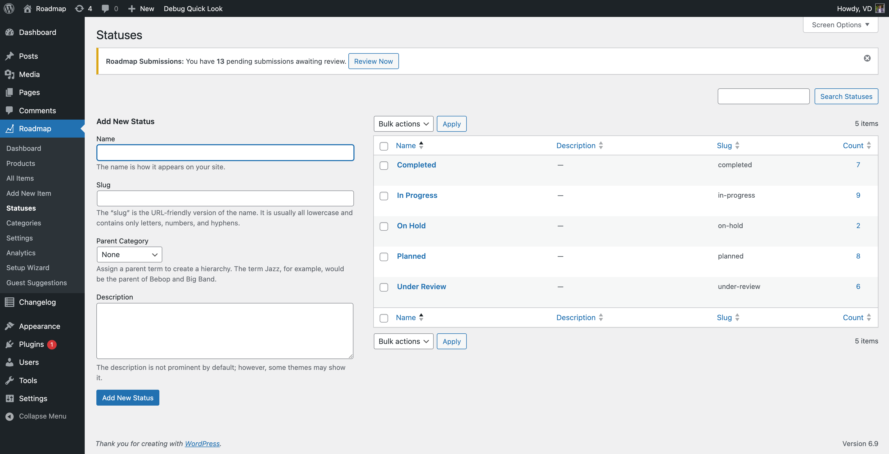
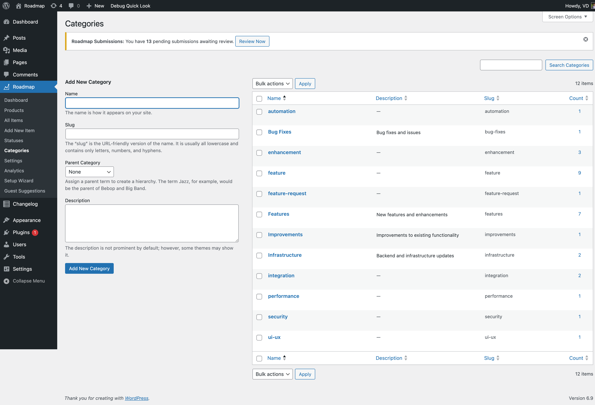

# Settings & Configuration

Configure Product Roadmap to match your needs. From display options to voting rules, all settings are managed from the Roadmap menu.

---

## Accessing Settings

Go to **Roadmap > Settings** in your WordPress admin.

Settings are organized into tabs:
- General
- Display
- Voting
- Pro Features (with Pro addon)

---

## General Settings

### Basic Configuration

| Setting | Description | Default |
|---------|-------------|---------|
| Roadmap Slug | URL base for items | `roadmap` |
| Enable Archive | Show archive page at /roadmap/ | Yes |
| Items Per Page | Default pagination | 20 |

### Post Type Settings

| Setting | Description | Default |
|---------|-------------|---------|
| Public | Items visible to search engines | Yes |
| Has Archive | Enable archive page | Yes |
| Supports | Enabled features (title, editor, etc.) | All |

### Permalink Structure

After changing slugs, visit **Settings > Permalinks** and click Save to refresh rewrite rules.

---

## Display Settings {#display}

### Template Options

| Setting | Description | Options |
|---------|-------------|---------|
| Default Template | Layout for shortcode | Kanban, List, Grid, Idea Box |
| Show Progress | Display progress bars | Yes/No |
| Show Votes | Display vote counts | Yes/No |
| Show Status | Display status badges | Yes/No |

### Item Display

| Setting | Description | Default |
|---------|-------------|---------|
| Show Priority | Display priority badge | No |
| Show Category | Display category label | No |
| Show Date | Display publish date | No |
| Show Author | Display item author | No |

### Single Item Page

| Setting | Description | Default |
|---------|-------------|---------|
| Enable Single | Allow individual item pages | Yes |
| Single Template | Template for item pages | Default |
| Show Related | Display related items | Yes |

---

## Voting Settings {#voting}

### Enable/Disable

| Setting | Description | Default |
|---------|-------------|---------|
| Allow Voting | Master switch for voting | Yes |
| Show Vote Count | Display number of votes | Yes |
| Show Voters | List who voted | No |

### Permissions

| Setting | Options | Description |
|---------|---------|-------------|
| Who Can Vote | Logged-in only, Guests allowed, Specific roles | Who can submit votes |
| Votes Per User | 1, Unlimited | Votes allowed per item |
| Require Email | Yes/No | Guest email verification |

### Guest Voting

| Setting | Description | Default |
|---------|-------------|---------|
| Allow Guest Votes | Non-logged-in users can vote | Yes |
| Guest Tracking | How to prevent duplicates | IP address |
| Rate Limit | Prevent rapid voting | Enabled |

### Voting UI

| Setting | Description | Default |
|---------|-------------|---------|
| Vote Button Style | Button appearance | Default |
| Vote Button Text | Custom button text | "Vote" |
| Voted Text | Text after voting | "Voted" |

---

## Status Configuration

### Default Statuses

Product Roadmap includes four statuses:

| Status | Slug | Color |
|--------|------|-------|
| Under Review | under-review | Gray |
| Planned | planned | Blue |
| In Progress | in-progress | Yellow |
| Complete | complete | Green |

### Managing Statuses

Go to **Roadmap > Statuses** to:
- Add new statuses
- Edit existing status names and colors
- Delete unused statuses
- Reorder workflow

### Adding a Status

1. Go to **Roadmap > Statuses**
2. Enter name (e.g., "On Hold")
3. Enter slug (e.g., "on-hold")
4. Choose color
5. Click **Add New Status**

### Deleting a Status

Before deleting:
1. Reassign items using that status
2. Or they'll become "uncategorized"

---

## Category Settings

### Managing Categories

Go to **Roadmap > Categories** to organize items.

Categories are hierarchical - you can have parent/child relationships.

### Creating Categories

1. Go to **Roadmap > Categories**
2. Enter name (e.g., "User Interface")
3. Optionally select parent category
4. Add description
5. Click **Add New Category**

---

## Pro Features Settings {#pro}

> **Pro Feature** - This tab appears when Pro addon is active.

### Feature Toggles

Enable or disable Pro features:

| Feature | What It Does |
|---------|--------------|
| Analytics Dashboard | Vote tracking and metrics |
| Multi-Product | Separate product roadmaps |
| Timeline View | Gantt chart display |
| Drag & Drop | Visual item management |
| Import/Export | CSV bulk operations |
| Advanced Filtering | Additional filter options |
| Gutenberg Block | Visual block builder |

### Multi-Product Settings

| Setting | Description |
|---------|-------------|
| Enable Multi-Product | Turn on product taxonomy |
| Default Product | Product for new items |
| Show Product Filter | Display filter in shortcode |

### Drag & Drop Settings

| Setting | Description |
|---------|-------------|
| Enable Drag & Drop | Allow dragging items |
| Allowed Roles | Who can drag items |
| Frontend Enable | Allow on public pages |

### Analytics Settings

| Setting | Description |
|---------|-------------|
| Track Page Views | Count item views |
| Cache Duration | How long to cache stats |
| Dashboard Widget | Show in WP dashboard |

### Timeline Settings

| Setting | Description |
|---------|-------------|
| Default View | Starting zoom level |
| Show Dependencies | Display dependency lines |
| Show Assignees | Display user avatars |

---

## Shortcode Defaults

Set defaults that apply when shortcode parameters aren't specified.

### Display Defaults

| Setting | Shortcode Equivalent |
|---------|---------------------|
| Default Template | `template="kanban"` |
| Default Order | `orderby="date" order="desc"` |
| Default Limit | `limit="20"` |
| Default Status | `status="all"` |

### Voting Defaults

| Setting | Shortcode Equivalent |
|---------|---------------------|
| Show Votes | `show_votes="true"` |
| Show Progress | `show_progress="true"` |
| Allow Voting | `voting="true"` |

---

## Advanced Settings

### Performance

| Setting | Description | Default |
|---------|-------------|---------|
| Enable Caching | Cache shortcode output | Yes |
| Cache Duration | How long to cache | 5 minutes |
| Lazy Load | Load items on scroll | No |

### REST API

| Setting | Description | Default |
|---------|-------------|---------|
| Enable REST API | Allow API access | Yes |
| Public Endpoints | Unauthenticated access | Yes |
| Rate Limiting | API request limits | Enabled |

### Data Management

| Setting | Description |
|---------|-------------|
| Delete Data on Uninstall | Remove all data when deleting plugin |
| Export All Data | Download complete backup |
| Reset Settings | Restore default settings |

---

## Permissions

### Capability Mapping

| Capability | Who Has It | What It Does |
|------------|-----------|--------------|
| manage_roadmap | Administrators | Full access |
| edit_roadmap_items | Editors+ | Create/edit items |
| delete_roadmap_items | Editors+ | Delete items |
| publish_roadmap_items | Editors+ | Publish items |

### Customizing Permissions

Use a role management plugin to:
- Grant roadmap access to specific roles
- Create custom roles for roadmap managers
- Restrict access to certain features

---

## Troubleshooting Settings

### Settings not saving

- Check user permissions
- Verify JavaScript is working
- Clear browser cache
- Try different browser

### Reset to defaults

1. Go to **Roadmap > Settings**
2. Scroll to bottom
3. Click **Reset to Defaults**
4. Confirm the action

### Export/Import Settings

**Export:**
1. Go to **Roadmap > Settings > Advanced**
2. Click **Export Settings**
3. Save the JSON file

**Import:**
1. Go to **Roadmap > Settings > Advanced**
2. Click **Import Settings**
3. Select saved JSON file
4. Apply imported settings

---

## Best Practices

### Start Simple

1. Use default settings initially
2. Adjust based on actual needs
3. Don't enable everything at once

### Document Your Setup

- Note customizations you make
- Keep track of why settings were changed
- Review settings periodically

### Test Changes

- Use staging site for major changes
- Verify frontend after adjustments
- Check edge cases (guests, different roles)

---

## Next Steps

| Goal | Guide |
|------|-------|
| Display your roadmap | [Display Options](display-options.md) |
| Set up voting | [Voting & Feedback](voting-feedback.md) |
| Track engagement | [Analytics](analytics.md) | Pro |
| Compare features | [Free vs Pro](free-vs-pro.md) |
