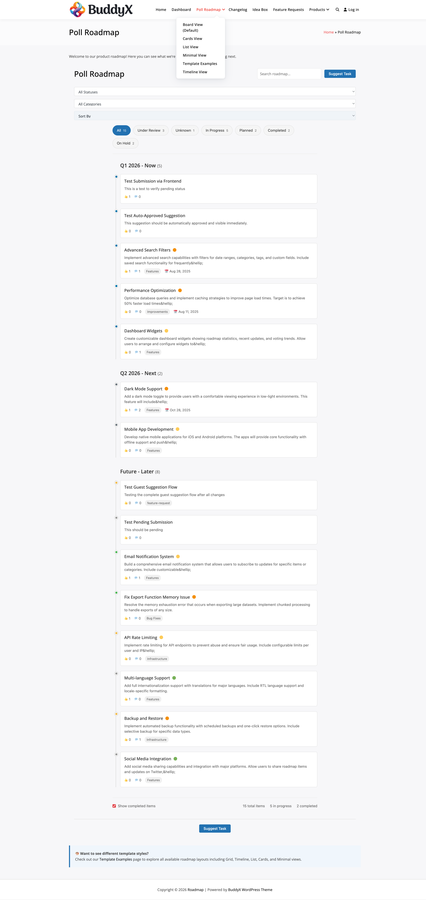

# Timeline View (Gantt Chart)

> **Pro Feature** - This feature requires the [Product Roadmap Pro](https://wbcomdesigns.com/downloads/product-roadmap-pro/) addon.

Visualize your roadmap as an interactive timeline. Plan releases, track progress, and communicate schedules with a Gantt-style chart.

---

## What is Timeline View?

Timeline view displays your roadmap items on a horizontal calendar:
- Each item shows as a bar spanning its date range
- Progress is visible at a glance
- Dependencies show connections between items
- Navigate through time easily

---

## Enabling Timeline View

### Requirements

1. Pro addon installed and activated
2. Items have target dates set
3. Timeline enabled in settings

### Enable the Feature

1. Go to **Roadmap > Settings > Pro Features**
2. Enable "Timeline View"
3. Save changes

### Set Item Dates

For items to appear on the timeline:
1. Edit a roadmap item
2. Set the **Target Start Date**
3. Set the **Target End Date**
4. Update the item

Items without dates won't appear on the timeline.

---

## Displaying Timeline



### Shortcode

```
[roadmap template="timeline"]
```

### With Product Filter

```
[roadmap template="timeline" product="mobile-app"]
```

### With Status Filter

```
[roadmap template="timeline" status="in-progress,planned"]
```

---

## View Modes

The timeline offers five zoom levels.

### Day View

Shows individual days. Use for:
- Sprint planning
- Short-term work (1-2 weeks)
- Detailed scheduling

### Week View

Shows weeks. Use for:
- Monthly planning
- Iteration tracking
- Team capacity view

### Month View (Default)

Shows months. Use for:
- Quarterly planning
- Release schedules
- Stakeholder presentations

### Quarter View

Shows quarters (Q1, Q2, Q3, Q4). Use for:
- Yearly roadmaps
- Strategic planning
- Executive summaries

### Year View

Shows full years. Use for:
- Multi-year planning
- Long-term vision
- Historical overview

### Switching Views

Users can switch between views using buttons above the timeline:
- Day | Week | Month | Quarter | Year

---

## Timeline Elements

### Item Bars

Each roadmap item appears as a horizontal bar:
- **Position**: Start date to end date
- **Color**: Based on status
- **Length**: Duration of work

### Progress Indicator

Bars show completion progress:
- Filled portion = percentage complete
- Empty portion = remaining work
- 100% = fully colored bar

### Status Colors

| Status | Color |
|--------|-------|
| Under Review | Gray |
| Planned | Blue |
| In Progress | Yellow/Orange |
| Complete | Green |

Colors match your status configuration.

### Assignee Avatars

If assignees are set, their avatar appears on the item bar. Helps identify who's responsible at a glance.

### Today Marker

A vertical line shows the current date. Quickly see what's past, current, and future.

---

## Dependencies

Show relationships between items.

### Setting Dependencies

1. Edit a roadmap item
2. Find the **Dependencies** section
3. Select items this one depends on
4. Update the item

### On the Timeline

Dependencies appear as lines connecting items:
- Arrow points from dependency to dependent item
- Shows which items must complete first
- Highlights blocking relationships

### Use Cases

- Feature A must ship before Feature B
- Backend work blocks frontend work
- Design must complete before development

---

## Navigation

### Moving Through Time

**Arrow buttons**: Move forward or backward by current view interval
**Today button**: Jump to current date
**Date picker**: Jump to specific date

### Scrolling

Horizontal scroll moves through time. Click and drag on desktop, swipe on mobile.

### Zooming

Switch view modes to zoom in (Day) or out (Year).

---

## Shortcode Parameters

### Full Example

```
[roadmap
    template="timeline"
    product="mobile-app"
    status="planned,in-progress"
    view="month"
    show_dependencies="true"
    show_progress="true"
    show_assignees="true"
]
```

### Parameters

| Parameter | Options | Default |
|-----------|---------|---------|
| `template` | timeline | (required) |
| `view` | day, week, month, quarter, year | month |
| `show_dependencies` | true, false | true |
| `show_progress` | true, false | true |
| `show_assignees` | true, false | true |
| `start_date` | YYYY-MM-DD | Today minus 1 month |
| `end_date` | YYYY-MM-DD | Today plus 3 months |

---

## Use Cases

### Release Planning

**Scenario**: Plan your next quarter's releases.

```
[roadmap template="timeline" view="month" status="planned,in-progress"]
```

Shows all planned and in-progress work on a monthly timeline.

### Sprint View

**Scenario**: Show current sprint work to the team.

```
[roadmap template="timeline" view="day" status="in-progress"]
```

Day-level detail for active work.

### Stakeholder Presentation

**Scenario**: Show yearly roadmap to executives.

```
[roadmap template="timeline" view="quarter"]
```

Quarterly view for high-level planning discussions.

### Product-Specific Timeline

**Scenario**: Show mobile app timeline only.

```
[roadmap template="timeline" product="mobile-app" view="month"]
```

Filtered timeline for one product.

---

## Best Practices

### Date Accuracy

- Set realistic start and end dates
- Update dates when plans change
- Use progress to show actual completion

### Not Too Crowded

- Filter to relevant statuses
- Use appropriate zoom level
- Consider multiple timeline pages for different views

### Regular Updates

- Review timeline weekly
- Update progress on items
- Communicate changes to stakeholders

### Dependencies

- Only add meaningful dependencies
- Don't over-connect items
- Review dependency chains for accuracy

---

## Troubleshooting

### Items not appearing

- Check that items have both start and end dates
- Verify dates are within the visible range
- Ensure items are published (not drafts)

### Timeline not rendering

- Check for JavaScript errors in browser console
- Ensure Pro addon is active
- Try disabling other plugins temporarily

### Dependencies not showing

- Verify dependencies are set on items
- Check `show_dependencies="true"` in shortcode
- Ensure dependent items are visible

### Performance issues

- Reduce visible date range
- Filter to fewer statuses
- Use coarser view mode (month vs day)

---

## Get Timeline View

Timeline View is available with Product Roadmap Pro.

**Included in Pro:**
- Interactive Gantt chart
- 5 view modes
- Progress visualization
- Dependency lines
- Assignee avatars
- Date navigation

[Get Product Roadmap Pro →](https://wbcomdesigns.com/downloads/product-roadmap-pro/)

---

## Next Steps

| Goal | Guide |
|------|-------|
| Track engagement | [Analytics](analytics.md) | Pro |
| Manage multiple products | [Multi-Product](multi-product.md) | Pro |
| Bulk data management | [Import & Export](import-export.md) | Pro |
