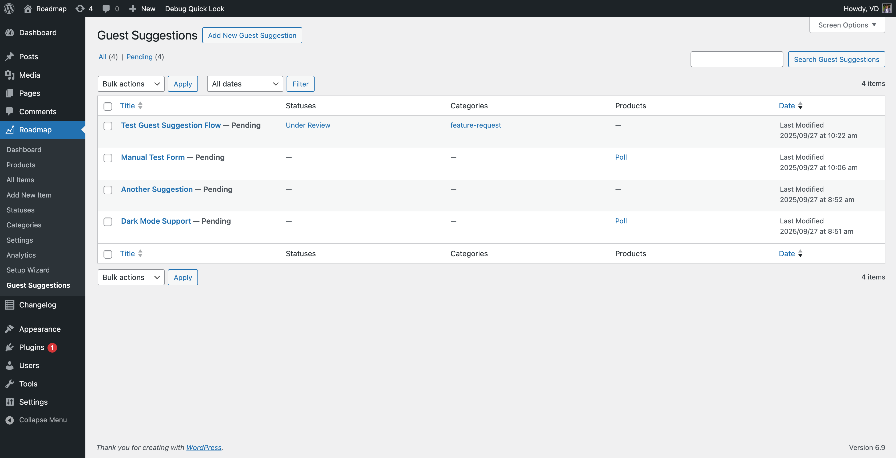
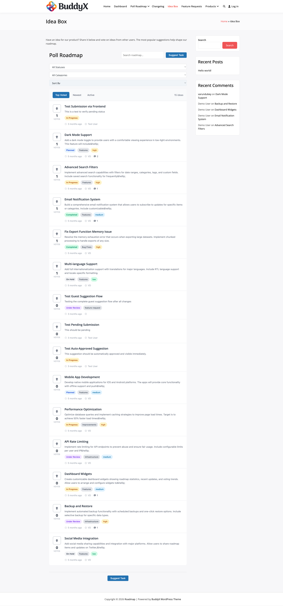

# Voting & User Feedback

Turn your roadmap into a feedback channel. Let users vote on features they want, leave comments, and submit their own ideas.

---

## Why Enable Voting?

Voting helps you:
- **Prioritize what matters** - See which features users want most
- **Validate ideas** - Test demand before building
- **Build trust** - Show users their voice matters
- **Save time** - Focus on high-impact features

---

## Setting Up Voting

### Enable Voting

1. Go to **Roadmap > Settings > Voting**
2. Set "Allow Voting" to **Yes**
3. Save changes

### Configure Who Can Vote

| Setting | Who Can Vote | Best For |
|---------|--------------|----------|
| Logged-in only | Registered WordPress users | Preventing spam, tracking voters |
| Guests allowed | Anyone, including anonymous | Maximum participation |
| Specific roles | Only certain user roles | Internal teams, beta users |

**To configure:**
1. Go to **Roadmap > Settings > Voting**
2. Set "Voting Permission" to your choice
3. Save changes

### Guest Voting Options

When guests can vote, you can require verification:

| Option | How It Works |
|--------|--------------|
| IP-based | One vote per IP address |
| Cookie-based | One vote per browser |
| No limit | Unlimited votes (not recommended) |

**Recommendation:** Use IP-based for public roadmaps to prevent abuse.

---

## How Voting Works

### User Experience

Users see vote buttons on each roadmap item:
- **Upvote (▲)** - I want this feature
- Vote count shows total upvotes
- Users can see what's popular at a glance

### Vote Display Options

Configure display under **Roadmap > Settings > Display**:

| Option | Result |
|--------|--------|
| Show vote count | Display total votes (e.g., "42 votes") |
| Show vote button | Allow voting directly on roadmap |
| Hide votes | Don't show voting UI |

### Single Item Pages

Each roadmap item has its own page with:
- Large vote button
- Current vote count
- Full description
- Comments section

Access via: `yoursite.com/roadmap/item-slug/`

---

## Comments & Discussions {#comments}

Let users discuss roadmap items.

### Enable Comments

1. Edit any roadmap item
2. In the "Discussion" box, check **Allow comments**
3. Update the item

Or enable for all new items:
1. Go to **Settings > Discussion**
2. Under "Default post settings", check "Allow comments"

### Moderating Comments

Comments appear in **Comments** menu like regular WordPress comments:
- Approve or reject
- Reply to feedback
- Mark as spam
- Bulk moderate

### Comment Best Practices

- Respond to comments promptly
- Thank users for feedback
- Explain decisions when declining requests
- Pin important announcements using a reply

---

## Feature Suggestions {#suggestions}

Let users submit their own ideas.

### Enable Suggestions

Use the suggestion form shortcode:

```
[roadmap_suggest_form]
```

This displays a form where users can submit:
- Feature title
- Description
- Optional category

### Where Suggestions Go

Submitted suggestions become roadmap items with:
- Status: "Under Review" (or your configured default)
- Visibility: Draft (requires your approval)

### Reviewing Suggestions



1. Go to **Roadmap > All Items**
2. Filter by **Draft** status
3. Review each submission
4. Publish approved items, delete inappropriate ones

### Suggestion Form Settings

Configure under **Roadmap > Settings > Suggestions**:

| Setting | Options |
|---------|---------|
| Require login | Yes/No |
| Auto-publish | Yes (goes live) / No (review first) |
| Notification email | Get alerts for new submissions |
| Required fields | Title, description, category |

---

## Voting Modes {#voting-modes}

### Standard Voting (Default)

Users can upvote items they support. One vote per user per item.

### Idea Box Mode

The Idea Box template focuses on voting and suggestions:

```
[roadmap template="ideabox"]
```



Features:
- Large, prominent vote buttons
- Built-in suggestion form
- Sorted by vote count
- Clean, minimal design

**Best for:** Collecting user ideas, feature request pages

### Combining with Statuses

Filter the voting view by status:

```
[roadmap template="ideabox" status="under-review"]
```

Shows only items being considered, perfect for "Vote on what we build next" pages.

---

## Pro: Advanced Feedback Features

> **Pro Features** - Require the Pro addon.

### Analytics Dashboard

See voting trends and engagement metrics:
- **Votes over time** - Track when voting activity spikes
- **Popular items** - Ranked list of most-voted features
- **Voting activity** - Recent votes with timestamps
- **User engagement** - Who's voting and commenting

[Learn about Analytics →](analytics.md)

### Vote Tracking by Product

With multi-product support, track votes per product:

```
[roadmap product="mobile-app" template="ideabox"]
```

Each product has its own voting leaderboard.

[Learn about Multi-Product →](multi-product.md)

### Export Vote Data

Export voting data to CSV for analysis:
1. Go to **Roadmap > Export**
2. Select "Include vote counts"
3. Download the CSV

[Learn about Import/Export →](import-export.md)

---

## Anti-Spam & Security

### Preventing Vote Manipulation

Product Roadmap includes protections:
- **IP tracking** - Detects same person voting multiple times
- **Rate limiting** - Blocks rapid-fire vote attempts
- **Cookie validation** - Ensures legitimate browser sessions

### v1.3.1 Security Update

Version 1.3.1 improved vote security by:
- Using only server-verified IP addresses
- Preventing IP spoofing attempts via headers
- Better detection of proxy voting

Update to the latest version for these protections.

---

## Best Practices

### Encouraging Votes

- Promote your roadmap in email newsletters
- Add a link in your app or product
- Share on social media when adding new items
- Thank users who vote in comments

### Responding to Feedback

| Situation | Response |
|-----------|----------|
| Popular request | "Thanks for voting! This is on our radar." |
| Completed item | "Great news - this shipped! Update coming soon." |
| Declined request | "Thanks for the input. Here's why we're going another direction..." |
| Duplicate | "Similar to [existing item]. Merged the votes there." |

### Keeping Voters Engaged

- Update item statuses regularly
- Comment when progress is made
- Mark items complete when shipped
- Celebrate shipped features with users

---

## Troubleshooting

### Votes not saving

- Check that voting is enabled in settings
- Verify user meets permission requirements
- Clear caching plugins
- Check browser console for JavaScript errors

### Duplicate votes appearing

- Enable IP-based duplicate detection
- Check for caching plugins interfering
- Ensure cookies are enabled in browser

### Suggestion form not appearing

- Verify shortcode: `[roadmap_suggest_form]`
- Check page isn't cached
- Ensure user meets submission requirements

---

## Next Steps

| Goal | Guide |
|------|-------|
| Display your roadmap | [Display Options](display-options.md) |
| Track engagement metrics | [Analytics](analytics.md) | Pro |
| Manage multiple products | [Multi-Product](multi-product.md) | Pro |
