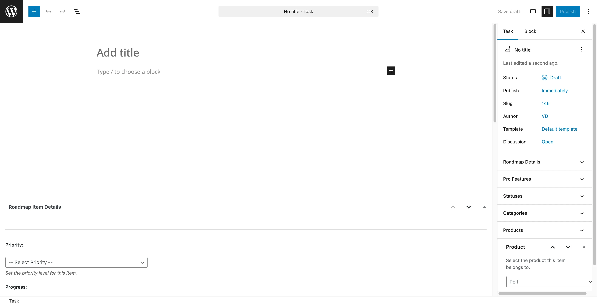
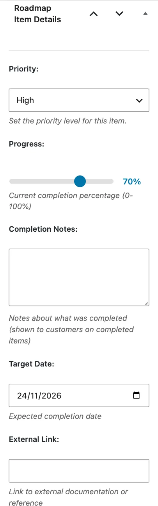
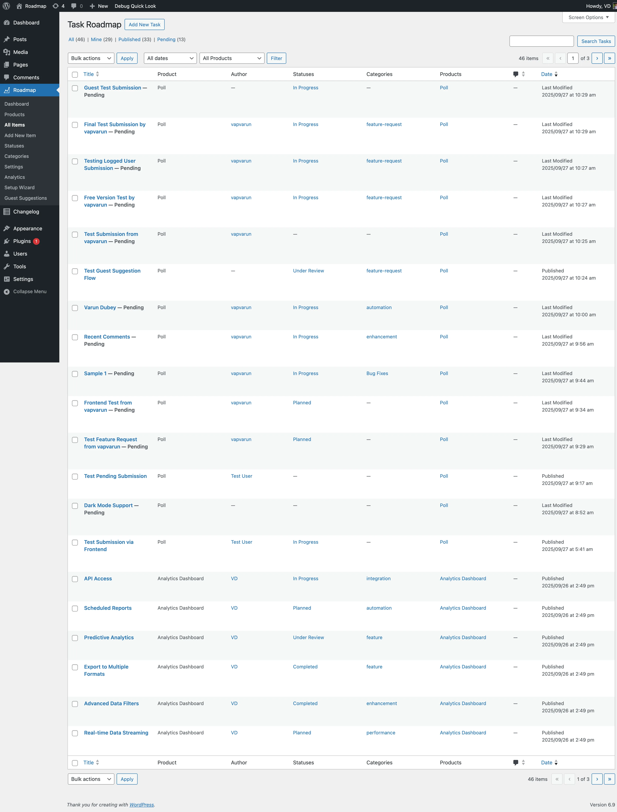

# Managing Roadmap Items

**Included in Free**

Roadmap items are a custom post type, so creating and editing them feels like working with a WordPress post, with a few roadmap-specific fields added.

## Creating an item

1. Go to **Roadmap > Add New**.
2. Enter a **Title** - keep it concise and specific ("Add dark mode toggle" reads better than "Dark mode").
3. Write a **Description** using the standard content editor. Explain the problem being solved, not just the feature name.
4. Keep the first sentence of the description clear. The board shows the first 20 words as the item summary, and items have no separate Excerpt field.
5. In the sidebar, assign a **Status** and one or more **Categories**. An item created in the admin has no status until you pick one.
6. Fill in the **Roadmap Item Details** box in the editor sidebar, under Statuses, Categories and Products (see below). In the classic editor it sits in the right-hand column.
7. Click **Publish**.

## Roadmap Item Details fields

The **Roadmap Item Details** box sits below the content editor.

*The Roadmap Item Details box for "Dark theme", showing Priority, Progress, Completion Notes, Target Date and External Link.*

| Field | Type and valid values | Where visitors see it |
|---|---|---|
| Priority | Menu: blank, Low, Medium, High or Critical. | A colored dot beside the title in the Minimal layout (green, yellow, orange, red), and a Priority badge in the item detail window. Not on the item's own page. |
| Progress | Slider from 0 to 100 in steps of 5. Default 0. | A progress bar in the item detail window when above 0. Pro layouts such as Board, Cards, List and Timeline also show it on each item. Not on the item's own page. |
| Completion Notes | Text box. | A "What was delivered" section in the item detail window and on the item's own page. It shows whenever you fill it in, whatever the status. |
| Target Date | Date picker. | A date beside the item in the Minimal layout, and in the item detail window. Not on the item's own page. |
| External Link | Web address (URL). | Not shown on your roadmap. It is stored with the item and returned by the REST API. |
| Vote Count | Number, read-only. | The vote count on the board, the item detail window and the item's own page. WordPress calculates it, so you cannot edit it. |

Type notes in Completion Notes as one paragraph. The edit screen saves it as a single line, so line breaks you type are removed.

### Pro fields

In Free, these fields show as greyed-out "Pro Feature" boxes under a **Pro Features** heading.

| Field | Type and valid values | Where visitors see it |
|---|---|---|
| Start Date (Pro) | Date picker. | The date range on Timeline layout items, when both Start Date and End Date are set. |
| End Date (Pro) | Date picker. | The date range on Timeline layout items. |
| Effort Estimate (Pro) | Menu: blank, XS (1-2 days), S (3-5 days), M (1-2 weeks), L (2-4 weeks), XL (1-2 months) or XXL (2+ months). | Not shown on your roadmap. It is stored and returned by the REST API. |
| GitHub Issue URL (Pro) | Web address (URL). | Not shown on your roadmap. It is stored and returned by the REST API. |

Changing an item's status does not change these fields. See [Move an Item to a New Status](06-changing-an-items-status.md).

## Editing existing items

Go to **Roadmap > All Items**.

- **Quick Edit** - hover over an item and click Quick Edit to change the title, date, status or category without opening the full editor. The Roadmap Item Details box is not part of Quick Edit.
- **Full edit** - click the item title to change any field, including the description and the Roadmap Item Details box.
- **Bulk actions** - select multiple items with the checkboxes, then choose an action from the Bulk actions menu (Edit or Move to Trash) and click Apply.

To change only the status, see [Move an Item to a New Status](06-changing-an-items-status.md).

The list has a **Statuses** column, a **Source** column and a **Categories** column. Source says **Created** for items you added and **Suggested** for items a member submitted. See [Review Pending Suggestions](07-reviewing-pending-suggestions.md).

### Members editing their own items

Members with the `roadmap_edit_own_items` and `roadmap_delete_own_items` capabilities can update and trash items they wrote themselves through the REST API. Authors and Subscribers have these by default. They cannot change items they did not write. Subscribers have no access to the WordPress item list.

## Deleting items

Trashing an item (from the list or a bulk action) moves it to the WordPress Trash, where it can be restored or permanently deleted like any other post. Deleting an item from **Manage** mode on the frontend also moves it to the Trash, so a mis-click is recoverable. Permanently deleting an item also deletes its votes.

## Organizing with categories

Categories group related items (feature areas, product sections, team ownership - whatever grouping is useful to you). See [Statuses and Categories](../settings/03-statuses-and-categories.md) for how to create and manage them.

## Filtering the admin list

Use the built-in search box and the status links above the list (All, Published, Pending, Draft, Trash) to narrow down a large roadmap. Click a status or category name in the **Statuses** or **Categories** column to list only items with that term.

## Next steps

| Goal | Guide |
|---|---|
| Show items on the frontend | [Displaying Your Roadmap](02-displaying-your-roadmap.md) |
| Turn on voting and comments | [Voting, Comments, and Suggestions](03-voting-comments-and-suggestions.md) |
| Move an item to a new status | [Move an Item to a New Status](06-changing-an-items-status.md) |
| Approve or reject member ideas | [Review Pending Suggestions](07-reviewing-pending-suggestions.md) |
| Help visitors search and filter | [Board Filters, Search and Sorting](08-board-filters-and-search.md) |
| Document a release | [Changelog](04-changelog.md) |
