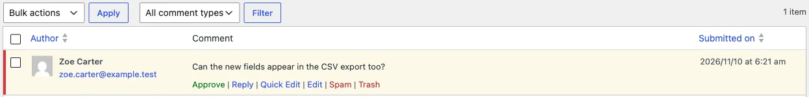

# Voting, Comments, and Suggestions

**Included in Free**

Turn your roadmap into a two-way feedback channel: let visitors vote on what they want, discuss items, and submit their own ideas.

## Voting

### Turning it on

Go to **Roadmap > Settings** and enable **Enable Voting**. Under **Who Can Vote**, choose **Anyone (including guests)** or **Logged in users only**.

### How it works

- Each item shows a vote button and its current vote count.
- One vote per user per item; clicking again removes the vote.
- After voting, the button shows a clear "Voted" state (a checkmark and pill) that stays visible even on themes that heavily restyle buttons.
- Guest votes are tracked by IP address. A guest's "already voted" state is recognized consistently between the board and the single item page, and stops being recognized if guest voting is later turned off.
- Vote counts reflect the number of people who voted - not a net score that a downvote could reduce.

### Hiding voting on one board

```
[roadmap show_voting="hide"]
```

This only hides voting on that particular shortcode instance. It can't turn voting on if it's disabled in Settings.

### Single item pages

Every roadmap item has its own page (`yoursite.com/roadmap/item-slug/`) with a large vote button, the current count, the full description, and comments. Guest and logged-in voting both work the same way here as on the board.

## Comments

### Turning it on

Go to **Roadmap > Settings** and enable **Enable Comments**. It is on by default. Comments are stored as standard WordPress comments.

Turning comments off in Settings closes new comments everywhere. Comments already posted stay visible on the item's page.

### Where visitors comment

Visitors comment on the item's own page. On the board they click an item, then **View Details & Comments**, and use the comment form under the item. Each board item also shows its comment count.

The form uses WordPress's normal comment system, so your **Settings > Discussion** rules apply:

- Who can comment: for example, whether visitors must be logged in.
- Approval: for example, whether you must approve each comment first.
- Spam checks: spam plugins such as Akismet, if active.
- Replies: threaded replies, if your theme and Discussion settings allow them.

To hide comment counts on one board, use `show_comments="hide"`. See [Board Filters, Search and Sorting](08-board-filters-and-search.md).

### Moderating



*The WordPress Comments screen with a comment from a member waiting for approval on the "Custom task fields" item, with Approve, Reply, Quick Edit, Edit, Spam and Trash links.*

1. Go to **Comments** in the admin sidebar. Comments on roadmap items show the item title under **In response to**.
2. Hover over a comment to **Approve**, **Reply**, **Edit**, mark it as **Spam**, or move it to the **Trash**.

Only approved comments count toward an item's comment count, and only members with an approved comment get status update emails. If you unapprove or trash a comment, its author stops getting those emails unless they also voted.

### Comment notifications

- **WordPress emails:** WordPress sends its normal new-comment and moderation emails, based on **Settings > Discussion**.
- **Plugin emails:** **Notify on new comment** on the [Notifications page](../settings/02-notifications.md) sends "[Your site] New comment on: Item title" to your notification addresses. It applies to comments sent through the roadmap REST API. Comments typed into the item page form use the WordPress emails above.
- **Members who commented** get an email when the item's status changes. See [Move an Item to a New Status](06-changing-an-items-status.md).

## Feature suggestions

Let logged-in members submit their own feature ideas. Each one is saved as a pending roadmap item until you review it.

### Turning it on

Go to **Roadmap > Settings** and enable **User Suggestions**. Configure:

- **Auto-approve user suggestions** - off by default. When on, suggestions publish immediately, bypassing manual review.
- **Default Status for Suggestions** - the status every new suggestion gets, such as Under Review. It applies whether or not you auto-approve.

Guest suggestions require the Pro addon; on Free, submitting an idea requires being logged in.

### The suggestion form

When **User Suggestions** is on, a "Suggest a feature" button appears directly on the `[roadmap]` board. Clicking it opens a form (title, description, and an optional category) without leaving the page - there's no separate shortcode to place.

### Reviewing suggestions

1. Go to **Roadmap > All Items** and click **Pending**.
2. Hover over a suggestion and click **Approve** to publish it, or **Reject** to move it to the Trash.

A pending-submissions admin notice appears when there's something to review; dismissing it stays dismissed until a new suggestion arrives. See [Review Pending Suggestions](07-reviewing-pending-suggestions.md) for the full steps.


## Notification emails for this activity

Configure who gets emailed, and for which of these three events, on the [Notifications settings page](../settings/02-notifications.md). Separately, voters and commenters on an item get emailed (with an unsubscribe link) when that item's status changes. See [Move an Item to a New Status](06-changing-an-items-status.md).

## Anti-spam, automatically

Votes and suggestions are rate-limited (per logged-in user, or per IP address for guests), and the suggestion form carries a hidden honeypot field to catch bots. None of this requires configuration - it's always on.

## Troubleshooting

**Vote button doesn't respond**
- Confirm **Enable Voting** is on in Settings.
- If a guest is trying to vote, confirm **Who Can Vote** allows guests.
- Check the browser console for JavaScript errors, and rule out a plugin conflict by disabling other plugins temporarily.

**Comments missing**
- Confirm **Enable Comments** is on in Settings.
- Check **Settings > Discussion** in WordPress itself allows comments.

**Suggestion form not appearing**
- Confirm **User Suggestions** is enabled in Settings and the board uses `[roadmap]`; the button is part of the board, not a separate shortcode.
- Confirm the visitor is logged in (Free requires login to suggest).

## Next steps

| Goal | Guide |
|---|---|
| Approve or reject member ideas | [Review Pending Suggestions](07-reviewing-pending-suggestions.md) |
| Email voters when an item moves | [Move an Item to a New Status](06-changing-an-items-status.md) |
| Let visitors search and filter | [Board Filters, Search and Sorting](08-board-filters-and-search.md) |
| Document a release | [Changelog](04-changelog.md) |
| Configure email recipients | [Notifications](../settings/02-notifications.md) |
