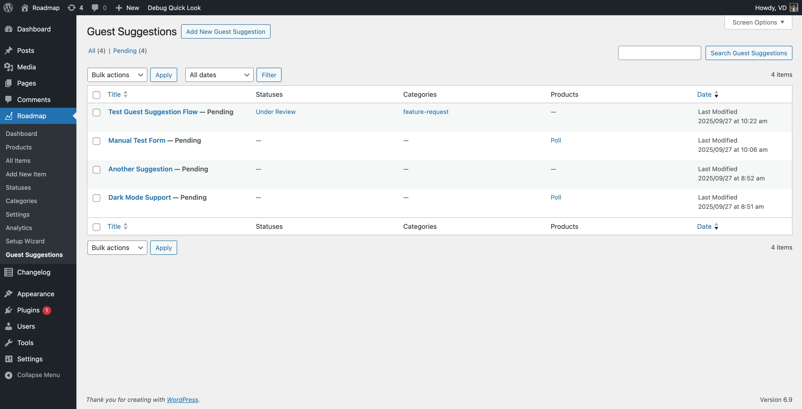

# Voting, Comments, and Suggestions

Turn your roadmap into a two-way feedback channel: let visitors vote on what they want, discuss items, and submit their own ideas.

## Voting

### Turning it on

Go to **Roadmap > Settings** and enable **Enable Voting**. Under **Who Can Vote**, choose **Anyone (including guests)** or **Logged in users only**.

### How it works

- Each item shows a vote button and its current vote count.
- One vote per user per item; clicking again removes the vote.
- After voting, the button shows a clear "Voted" state (a checkmark and pill) that stays visible even on themes that heavily restyle buttons.
- Guest votes are tracked by IP address. A guest's "already voted" state is recognized consistently between the board and the single item page, and stops being recognized if guest voting is later turned off.
- Vote counts reflect the number of people who voted - not a net score that a downvote could reduce.

### Hiding voting on one board

```
[roadmap show_voting="hide"]
```

This only hides voting on that particular shortcode instance. It can't turn voting on if it's disabled in Settings.

### Single item pages

Every roadmap item has its own page (`yoursite.com/roadmap/item-slug/`) with a large vote button, the current count, the full description, and comments. Guest and logged-in voting both work the same way here as on the board.

## Comments

### Turning it on

Go to **Roadmap > Settings** and enable **Enable Comments**. Comments use WordPress's native comment system, so standard moderation, threading, and spam handling (including Akismet, if active) all apply.

Turning comments off in Settings closes them everywhere, including the single item page.

### Moderating

Manage roadmap item comments the same way you manage any WordPress comment: **Comments** in the admin sidebar to approve, reply, or mark as spam.

## Feature suggestions

Let logged-in members submit their own feature ideas, which become draft roadmap items pending your review.

### Turning it on

Go to **Roadmap > Settings** and enable **User Suggestions**. Configure:

- **Auto-approve user suggestions** - off by default. When on, suggestions publish immediately with the status set in **Default Status for Suggestions**, bypassing manual review.
- **Default Status for Suggestions** - the status a suggestion gets when auto-approved.

Guest suggestions require the Pro addon; on Free, submitting an idea requires being logged in.

### The suggestion form

When **User Suggestions** is on, a "Suggest a feature" button appears directly on the `[roadmap]` board. Clicking it opens a form (title, description, and an optional category) without leaving the page - there's no separate shortcode to place.

### Reviewing suggestions

1. Go to **Roadmap > All Items**.
2. Filter by the suggestion default status (Under Review, unless you've changed it).
3. Review each submission, then publish, edit, or trash it.

A pending-submissions admin notice appears when there's something to review; dismissing it stays dismissed until a new suggestion arrives.



## Notification emails for this activity

Configure who gets emailed, and for which of these three events, on the [Notifications settings page](../settings/02-notifications.md). Separately, voters and commenters on an item get emailed (with an unsubscribe link) when that item's status changes.

## Anti-spam, automatically

Votes and suggestions are rate-limited (per logged-in user, or per IP address for guests), and the suggestion form carries a hidden honeypot field to catch bots. None of this requires configuration - it's always on.

## Troubleshooting

**Vote button doesn't respond**
- Confirm **Enable Voting** is on in Settings.
- If a guest is trying to vote, confirm **Who Can Vote** allows guests.
- Check the browser console for JavaScript errors, and rule out a plugin conflict by disabling other plugins temporarily.

**Comments missing**
- Confirm **Enable Comments** is on in Settings.
- Check **Settings > Discussion** in WordPress itself allows comments.

**Suggestion form not appearing**
- Confirm **User Suggestions** is enabled in Settings and the board uses `[roadmap]`; the button is part of the board, not a separate shortcode.
- Confirm the visitor is logged in (Free requires login to suggest).

## Next steps

| Goal | Guide |
|---|---|
| Document a release | [Changelog](04-changelog.md) |
| Configure email recipients | [Notifications](../settings/02-notifications.md) |
