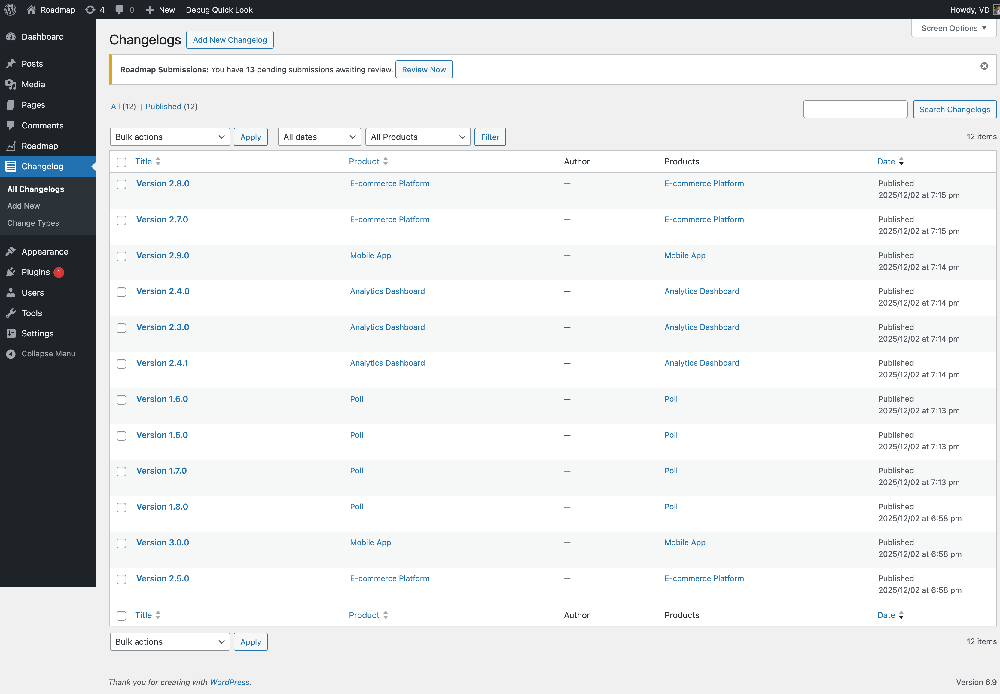
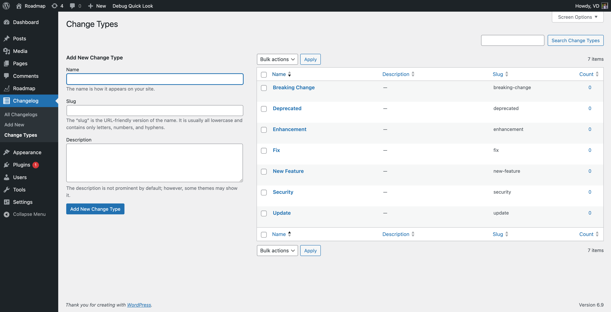
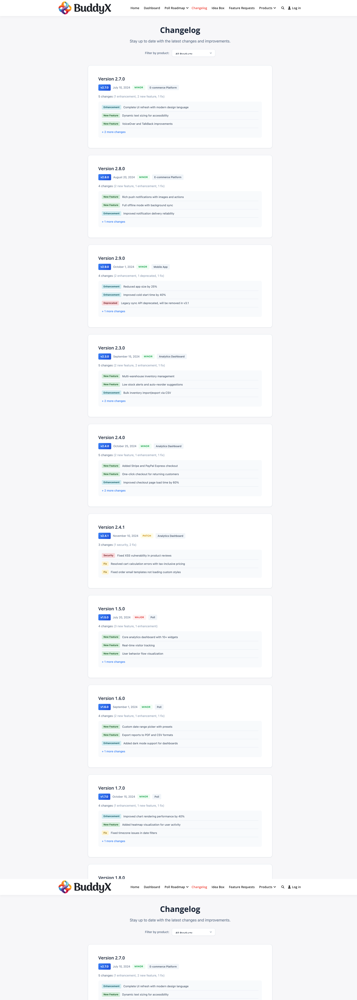

# Changelog

Document your releases and keep users informed about what shipped, separately from the roadmap itself.

## Creating an entry



1. Go to **Roadmap > Changelog > Add New**.
2. Enter a **Title** (typically the release name, e.g. "Version 2.1.0").
3. Write the release notes in the content editor.
4. Fill in the release fields in the sidebar:

| Field | Purpose |
|---|---|
| Version | The version number (e.g. "2.1.0"). |
| Release Date | When this version shipped. |
| Release Type | Major, Minor, or Patch. |

5. Optionally assign a **Product** (relevant once you're on Pro and managing more than one product).
6. Click **Publish**.

## Change types



Categorize individual changes within an entry using these built-in types:

| Type | Typical use |
|---|---|
| New Feature | Something added |
| Enhancement | An improvement to existing behavior |
| Fix | A bug fix |
| Update | A general change or dependency bump |
| Deprecated | Something being phased out |
| Security | A security-related fix |
| Breaking Change | Requires action from the customer on upgrade |

Manage type colors at **Roadmap > Settings > Changelog Types** - each type has an editable color swatch.

## Displaying your changelog



```
[roadmap_changelog]
```

| Attribute | Options | Default |
|---|---|---|
| `product` | a product slug | (empty) shows your default product on Free |
| `id` | a single entry's post ID | (empty) |
| `limit` | number of entries | `10` |
| `show_date` | `true` / `false` | `true` |
| `collapsible` | `true` / `false` | `false` |
| `class` | extra CSS class | (empty) |

Entries are always ordered by release date, newest first; entries with no release date set are still included.

```
[roadmap_changelog limit="5" collapsible="true"]
```

### Archive and single pages

Visit `yoursite.com/roadmap-changelog/` to see every entry, or `yoursite.com/roadmap-changelog/version-2-1-0/` for a single entry's own page.

The changelog shortcode, single entry page, and archive all adopt your active theme's accent color and follow your theme's own light/dark toggle, the same as the rest of the plugin. If your theme ships a `roadmap/changelog-frontend.css` override, the changelog uses it automatically (also filterable with `roadmap_changelog_enqueue_frontend_css`).

## Best practices

- Publish the changelog entry when the release actually goes live.
- Keep version numbers consistent with your product's own versioning.
- Write for the people using your product, not for other developers - explain the benefit, not just the mechanism.
- Mention any breaking changes prominently, and near the top of the entry.

## Next steps

| Goal | Guide |
|---|---|
| Manage change type colors | [Notifications and Changelog Types](../settings/02-notifications.md#changelog-types) |
| See what Pro adds for changelogs | [Multi-Product and Pro Features](05-multi-product-and-pro-features.md) |
