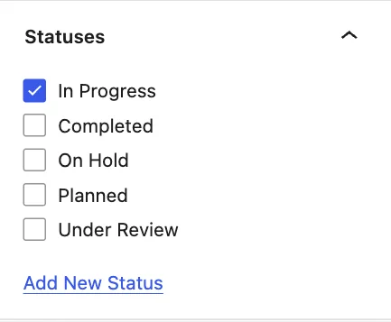

# Move an Item to a New Status

**Free + Pro**

A status tells visitors where an item stands, such as Planned, In Progress or Completed. This page shows every way to change it, what visitors see, and who gets an email.

## Change the status from the edit screen

1. Go to **Roadmap > All Items** and open the item, for example "Dark theme".
2. Find the **Statuses** panel. In the block editor it is in the sidebar under the **Post** tab. In the classic editor it is a box beside the content.
3. Tick the new status and untick the old one.
4. Click **Update**.

*The Statuses panel on the edit screen for "Dark theme", with the In Progress status ticked.*

Tick only one status. If an item has two, the board uses the first one in the list and ignores the other.

## Other ways to change a status

| Where | How | Who can do it |
|---|---|---|
| Quick Edit | In **Roadmap > All Items**, hover the item, click **Quick Edit**, change the **Statuses** checkboxes, then click **Update**. | Anyone who can edit the item |
| Bulk Edit | Select several items, choose **Edit** in **Bulk actions**, tick a status, then click **Update**. | Anyone who can edit the items |
| Frontend Manage mode | On your roadmap page, click **Manage Mode**, click **Edit** on an item, pick a **Status**, then save. | Administrators, or Editors on a board that uses `mode="manage"` |
| Drag and drop (Pro) | In the Board layout, switch to Manage mode and drag the item to another status column. | Administrators, or Editors on a board that uses `mode="manage"` |

The **Statuses** column in the item list shows each item's status. Click a status name there to list only the items that have it.

Bulk Edit is the standard WordPress tool. After a bulk change, open one item and check it has just one status ticked.

## What visitors see

The board reads the status every time it loads, so the change shows as soon as visitors reload the page.

In the Minimal layout, which is the layout Free uses, an item moves to a group based on its status:

| Group | Statuses |
|---|---|
| Now | In Progress (and the slugs `development` and `testing`) |
| Next | Planned (and the slugs `approved` and `scheduled`) |
| Future - Later | Every other status, including Completed, On Hold, Under Review and any status you add |

Visitors also see:

- The status color on the dot next to the item.
- The status tab counts above the list, such as "In Progress 4".
- The status badge in the item detail window and on the item's own page.
- The Completed, Released and Cancelled items hidden when they untick **Show completed items**.

A status you create gets a grey dot until you add a color in your theme CSS. See [Statuses and Categories](../settings/03-statuses-and-categories.md#giving-a-custom-status-a-color).

Pro layouts show the same status in their own way. For example, the Board layout has one column per status.

## What happens to votes, progress and notes

- **Votes** stay on the item. A status change never resets them, and visitors can still vote on a completed item.
- **Progress** does not change on its own. Set it to 100 when work finishes.
- **Completion Notes** show whenever you fill them in, whatever the status. Add a note such as "Dark theme shipped in 2.4" when you complete an item. See [Managing Roadmap Items](01-managing-roadmap-items.md#roadmap-item-details-fields).

## Emails sent when a status changes

When an item's status changes, Product Roadmap emails the people following it. You do not need to do anything.

- **Who gets it:** Logged-in members who still have a vote on the item, and members who left an approved comment on it. A member who removed their vote is not emailed. Visitors who voted as guests have no account, so they get no email.
- **When:** Only when the status really changes, and then once per change. Saving an item without changing its status, trashing it or moving it between draft and published sends nothing.
- **What it says:** The subject is "[Your site] Status update: Item title". The body lists the item, the old status, the new status and a link.
- **Unsubscribe:** Every email ends with an unsubscribe link. One click stops all roadmap emails to that member. Product Roadmap has no screen to turn emails back on for a member.
- **Master switch:** Emails are sent only while **Enable Email Notifications** is on in **Roadmap > Settings > Notifications**. The per-event toggles on that tab do not affect them.
- **Delivery:** Emails go out in the background, 50 people per batch with one batch each minute. A popular item can take several minutes to reach everyone. This needs WP-Cron to run, which it does when your site gets visits.

The status email goes out for every route above, including Manage mode and drag and drop.

## Next steps

| Goal | Guide |
|---|---|
| Add progress and completion notes | [Managing Roadmap Items](01-managing-roadmap-items.md) |
| Review ideas members submitted | [Review Pending Suggestions](07-reviewing-pending-suggestions.md) |
| Add or color a status | [Statuses and Categories](../settings/03-statuses-and-categories.md) |
| Choose who gets admin emails | [Notifications](../settings/02-notifications.md) |
