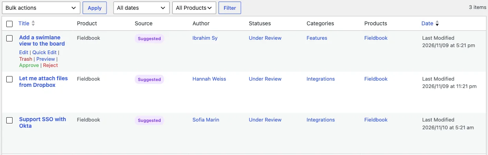

# Review Pending Suggestions

**Included in Free**

When a member suggests a feature, it waits in your admin for review. Visitors do not see it on the board until you approve it. This page shows how to find, approve and reject suggestions.

## How a suggestion arrives

A logged-in member clicks **Suggest a feature** on your roadmap page and fills in the form:

- **Title** and **Description** are required.
- **Category**, **Priority** and **External Link** are optional. If the member skips Priority, it is saved as Medium.

The suggestion is saved as **Pending**. It gets the status you chose in **Default Status for Suggestions**, which is Under Review unless you changed it. It is also marked **Suggested** in the Source column.

Turn on **User Suggestions** in **Roadmap > Settings** first. See [Voting, Comments, and Suggestions](03-voting-comments-and-suggestions.md#feature-suggestions).

### Who can submit

- Logged-in members with the `roadmap_suggest` capability. Administrator, Editor, Author, Contributor and Subscriber roles all have it.
- Guests cannot submit on Free. Guest suggestions need Product Roadmap Pro.

### What the member sees

After sending, the member sees a "Thank you for your suggestion!" message. The member gets no email and has no page that lists their suggestions. Tell members in your own words that you review ideas before they appear.

### Anti-spam protection

This is always on and needs no setup:

- Each member can send 5 suggestions per hour. After that the form shows "You are doing that too often."
- The form has a hidden field that real people never fill in. If a bot fills it in, the form looks successful but nothing is saved.

## Find pending suggestions

You get two reminders:

- A yellow notice on the Roadmap admin screens: "You have 1 pending submission awaiting review." Click **Review Now** to open the list.
- A **Pending** link, with a count, above the item list. It appears only when something is waiting.

Dismiss the notice with its X button. It stays hidden for you until more suggestions arrive than were waiting when you dismissed it.

To review, go to **Roadmap > All Items** and click **Pending**. Suggestions such as "Support SSO with Okta" show a **Suggested** label in the Source column.

*The Pending view of Roadmap Items, with Approve and Reject links under the suggestion "Support SSO with Okta".*

If **Notify on new suggestion** is on, you also get an email with a link to the suggestion. See [Notifications](../settings/02-notifications.md).

## Approve a suggestion

1. Hover over the suggestion in the Pending list.
2. Click **Approve**.

The item is published at once and appears on the board. You see the message "Support SSO with Okta" has been approved and published!

Approving does not change the status. The item keeps the Default Status for Suggestions, such as Under Review. Open the item and pick a new status when you are ready. See [Move an Item to a New Status](06-changing-an-items-status.md).

To fix the wording first, click the title, edit it, then click **Publish**.

## Reject a suggestion

1. Hover over the suggestion in the Pending list.
2. Click **Reject**. The link changes to **Confirm reject** and a note says "Rejects this submission."
3. Click **Confirm reject** within 5 seconds.

The suggestion moves to the WordPress Trash. The member is not told. If your site has the Trash turned off, the suggestion is deleted instead.

### Restore a rejected suggestion

1. Go to **Roadmap > All Items** and click **Trash**.
2. Hover over the item and click **Restore**.

The item returns to Pending, so you can approve it later. Deleting it permanently also deletes its votes.

## Skip the review

Turn on **Auto-approve user suggestions** in **Roadmap > Settings** to publish every suggestion at once. Auto-approved items still get the Default Status for Suggestions and the Suggested label. Use this only on a roadmap with trusted members.

## Who can approve and reject

Approve needs permission to publish posts, and Reject needs permission to delete posts. The links show for Editors and Administrators.

## Next steps

| Goal | Guide |
|---|---|
| Change what happens after approval | [Move an Item to a New Status](06-changing-an-items-status.md) |
| Turn suggestions on or off | [Voting, Comments, and Suggestions](03-voting-comments-and-suggestions.md) |
| Choose who gets the new suggestion email | [Notifications](../settings/02-notifications.md) |
