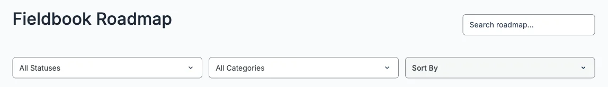

# Board Filters, Search and Sorting

**Free + Pro**

Visitors can search your roadmap, narrow it by status or category, and change the order. This page shows what they get, how to start a board pre-filtered, and how to hide the controls.

## What visitors can use



*The filter bar above the Fieldbook roadmap: search box, Status, Category and Sort by menus.*

| Control | What it does | Free | Pro |
|---|---|---|---|
| Search box | Finds items by words in the title or description. | Yes | Yes |
| Status menu | Shows only items with one status, such as In Progress. | Yes | Yes |
| Category menu | Shows only items in one category, such as Integrations. | Yes | Yes |
| Sort menu | Changes the order of the whole board. | Yes | Yes |
| Product menu | Switches between your products. | No | Yes |

Search and filters look through your whole roadmap, not only the items already on screen. Changing a filter starts the list again from the first page.

### Search

The search box sits at the top right of the board with the placeholder "Search roadmap...". Results update about a third of a second after the visitor stops typing. Searching for "slack" finds "Slack notifications".

### Status and category

Each menu starts on "All Statuses" or "All Categories" and lists every status or category you have created. Visitors pick one at a time. Set them up in [Statuses and Categories](../settings/03-statuses-and-categories.md).

### Sort

| Sort option | Order |
|---|---|
| Sort By (nothing chosen) | Newest first |
| Most Voted | Most votes first. Items with no votes come last. |
| Most Recent | Newest first |
| Most Discussed | Most comments first |
| Highest Priority | Critical, High, Medium, then Low |
| Title (A-Z) | Alphabetical |

### Extra tabs in the Minimal layout

The Minimal layout, which Free uses, also shows a row of status tabs with counts, such as "In Progress 4". It also shows a **Show completed items** checkbox. These work on the items already loaded, so after a visitor clicks **Load more** the counts grow.

### Product menu (Pro)

With Pro, a product menu appears in the filter bar of any board that is not pinned to one product. Visitors use it to switch products. See [Multi-Product and Pro Features](05-multi-product-and-pro-features.md).

## Start a board pre-filtered

Add attributes to the shortcode. The visitor can still change the menus unless you hide the filter bar.

```
[roadmap status="in-progress" sort="votes"]
```

This opens on In Progress items, most voted first. Visitors can pick "All Statuses" to see everything.

| Attribute | Example | Effect |
|---|---|---|
| `status` | `status="planned"` | Starts the Status menu on one status. |
| `category` | `category="integrations"` | Starts the Category menu on one category. |
| `sort` | `sort="votes"` | Starts the Sort menu on `votes`, `recent`, `comments`, `priority` or `title`. |
| `limit` | `limit="10"` | Shows exactly 10 items with no Load more button. Use 1 to 100. |
| `priority` (Pro) | `priority="high"` | Shows only items with that priority. Visitors cannot change it. |
| `date_from` and `date_to` (Pro) | `date_from="2026-01-01"` | Shows only items whose Target Date falls in the range. Use `YYYY-MM-DD`. |

Each of `status` and `category` takes one slug.

## Show or hide parts of the board

| Attribute | Default | What `false` or `hide` does |
|---|---|---|
| `show_title` | `true` | Hides the board heading, such as "Fieldbook Roadmap". |
| `show_search` | `true` | Hides the search box. |
| `show_filters` | `true` | Hides the whole filter bar: status, category, sort and product menus. |
| `show_voting` | follows Settings | `show_voting="hide"` hides votes on this board. |
| `show_comments` | follows Settings | `show_comments="hide"` hides comments on this board. |

`show_search="false"` hides only the search box, and `show_filters="false"` hides only the menus. Use both to make a fixed board that visitors cannot change.

`show_voting` and `show_comments` cannot turn a feature on. Turn it on first in **Roadmap > Settings**.

## What a board shows by default

- Items per page come from **Items Per Page** in **Roadmap > Settings**, which is 100 unless you change it. A **Load more** button shows the rest.
- Only published items appear. Pending suggestions stay hidden until you approve them.
- The order is newest first.
- Filters and search reset when the visitor reloads the page, and the page address does not store them.

## A board for one product

A board shows one product when you use the Free plugin, or when the shortcode names a product, such as `product="fieldbook"`. On these boards:

- The Product menu is hidden.
- Status, category, search and sort work as on any other board.

Free always shows its one product. In Free, a shortcode that names any other product shows your main product and a notice to editors.

## Next steps

| Goal | Guide |
|---|---|
| See every shortcode attribute | [Shortcode reference](../developer-guide/04-shortcode-reference.md) |
| Place the board on a page | [Displaying Your Roadmap](02-displaying-your-roadmap.md) |
| Add statuses and categories to filter by | [Statuses and Categories](../settings/03-statuses-and-categories.md) |
