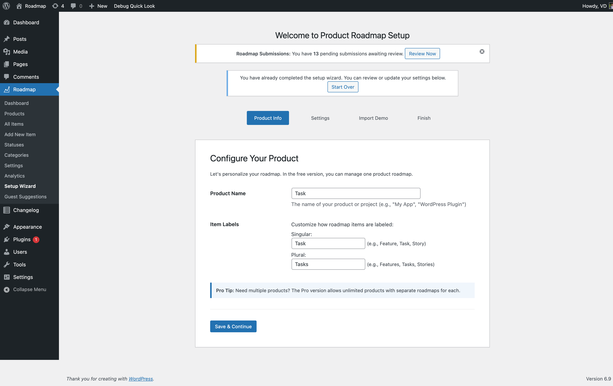

# Setup Wizard Walkthrough

The setup wizard opens automatically the first time you activate Product Roadmap. You can also reach it any time at **Roadmap > Setup Wizard**.

## Step 1: Configure your product

- **Product Name** - the name of your product or project (for example, "My App"). It appears in menu titles and page headings.
- **Item Labels** - customize what roadmap items are called. Set a **Singular** label (for example, "Feature", "Task", "Story") and a **Plural** label (for example, "Features", "Tasks", "Stories"). These labels appear throughout the admin interface.

> The free version manages one product roadmap. Pro allows unlimited products, each with its own roadmap.

## Step 2: Basic settings

- **Enable Voting** - let users vote on roadmap items.
- **Guest Voting** - allow non-logged-in users to vote, tracked by IP address.
- **Enable Comments** - let users comment on roadmap items.

These match the toggles on the Settings screen, so you can change any of them later without re-running the wizard.

## Step 3: Import demo content (optional)

Demo content includes 10 sample roadmap items across different statuses, various priority levels and categories, and example votes and comments. It's a quick way to see how a populated roadmap looks before you add real items.

- Leave the checkbox ticked and click **Import & Continue** to add the demo content.
- Click **Skip** to move on without it.

If a roadmap page already exists, the wizard reuses it instead of creating a duplicate. Otherwise, finishing the wizard creates a page titled "{Your Product} Roadmap" with the `[roadmap]` shortcode already added.

## Step 4: Finish

The wizard saves your configuration and creates the roadmap page (if one didn't already exist), then gives you quick links to view the page, edit it, or add your first real item.

## Re-running the wizard

Go to **Roadmap > Setup Wizard** at any time. If you've already completed it, you'll see a **Start Over** option. Starting over lets you reconfigure the settings above - it does not delete existing roadmap items or create a duplicate page.

## Next step

[Add your first item and display your roadmap](04-quick-start.md)
