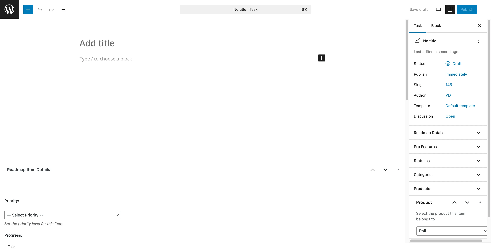

# Quick Start

Once the plugin is active and the setup wizard has run, here's the fastest path to a working public roadmap.

## Add your first item



1. Go to **Roadmap > Add New**.
2. Enter a title (for example, "Dark Mode Support").
3. Add a description explaining the feature.
4. In the sidebar, set a **Status** (default: Planned), and optionally a **Category**.
5. In the **Roadmap Item Details** meta box, set a **Priority** and **Progress** percentage if you want them.
6. Click **Publish**.

## Display your roadmap

1. Create a new page (for example, "Our Roadmap").
2. Add the shortcode: `[roadmap]`
3. Publish the page.

`[roadmap]` with no attributes shows your default product's board using the Minimal layout, with every published item visible (a Load more button appears for large boards).

A few common variations:

```
[roadmap]                       Default display
[roadmap status="planned"]      Only items with the Planned status
[roadmap sort="votes"]          Most-voted items first
[roadmap show_voting="hide"]    Hide voting on this board
```

See the [full shortcode reference](../developer-guide/04-shortcode-reference.md) for every available attribute.

## What's next

| Goal | Guide |
|---|---|
| Add and organize items day to day | [Managing Roadmap Items](../admin-guide/01-managing-roadmap-items.md) |
| Turn on voting, comments, and suggestions | [Voting, Comments, and Suggestions](../admin-guide/03-voting-comments-and-suggestions.md) |
| Publish release notes | [Changelog](../admin-guide/04-changelog.md) |
| Configure notification emails | [Notifications](../settings/02-notifications.md) |

## Troubleshooting first setup

**Roadmap page is blank**
- Make sure at least one item is published (not a draft).
- Check the shortcode syntax - it should read exactly `[roadmap]`.
- Clear any caching plugin's cache.

**Voting doesn't respond**
- Go to **Roadmap > Settings** and confirm **Enable Voting** is on.
- If you expect guests to vote, confirm **Allow Guest Voting** is also on.

**Styles look broken**
- Switch to a default WordPress theme temporarily to rule out a theme conflict.
- Check the browser console for JavaScript errors.
