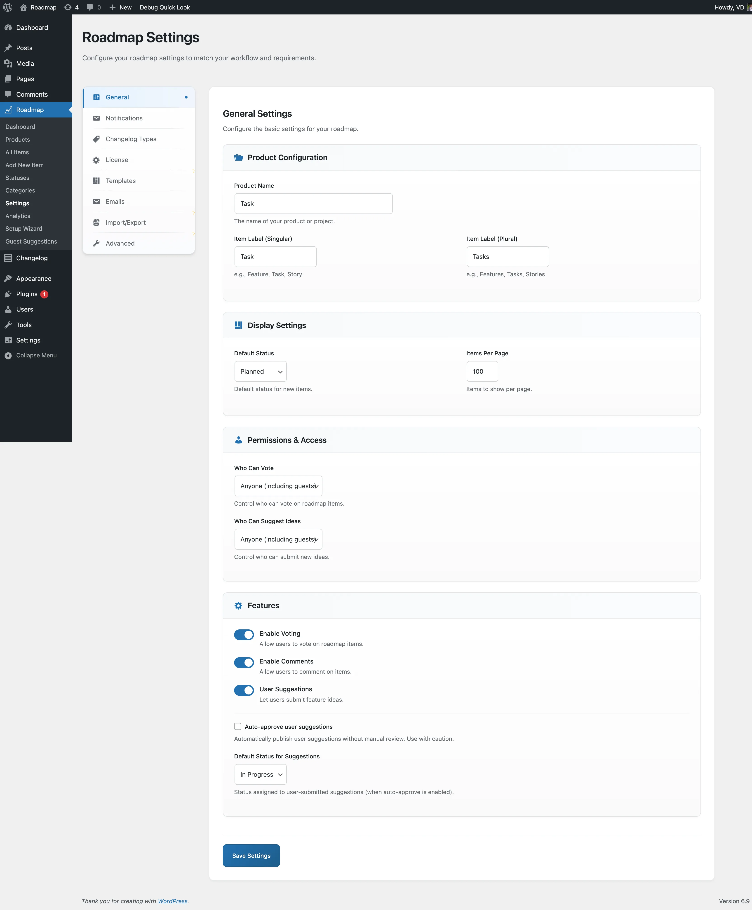

# General Settings

Go to **Roadmap > Settings** to configure the plugin. The General tab covers your product identity, display defaults, and who can vote, comment, and suggest.

## Product configuration

| Field | Description |
|---|---|
| Product Name | The name of your product or project. Appears in menu titles and page headings. |
| Item Label (Singular) | What to call one roadmap item (for example, "Feature", "Task", "Story"). |
| Item Label (Plural) | What to call multiple roadmap items (for example, "Features", "Tasks", "Stories"). |

## Display settings

| Field | Description |
|---|---|
| Default Status | The status assigned to new roadmap items when none is set explicitly. |
| Items Per Page | How many items load per page on the frontend board. |

## Permissions and access

| Field | Options | Notes |
|---|---|---|
| Who Can Vote | Anyone (including guests) / Logged in users only | Guest votes are tracked by IP address. |
| Who Can Suggest Ideas | Logged in users only | Guest suggestions require the Pro addon; on Free, only logged-in members can submit suggestions. |

## Features

| Toggle | Description |
|---|---|
| Enable Voting | Turns voting on or off site-wide. |
| Enable Comments | Turns comments on or off site-wide. |
| User Suggestions | Lets logged-in users submit their own feature ideas. |

When **User Suggestions** is on, two more options appear:

- **Auto-approve user suggestions** - publishes suggestions immediately without manual review. Leave this off unless you're confident about spam; every published suggestion is public right away.
- **Default Status for Suggestions** - the status applied to a user-submitted suggestion. This only takes effect when auto-approve is enabled; suggestions awaiting review keep their draft state until you publish them.

## Voting, comments, and suggestions in practice

For the full workflow (how a vote is cast, how a suggestion gets reviewed, guest behavior, and spam defenses), see [Voting, Comments, and Suggestions](../admin-guide/03-voting-comments-and-suggestions.md).

## Next steps

- [Notifications](02-notifications.md)
- [Statuses and Categories](03-statuses-and-categories.md)
