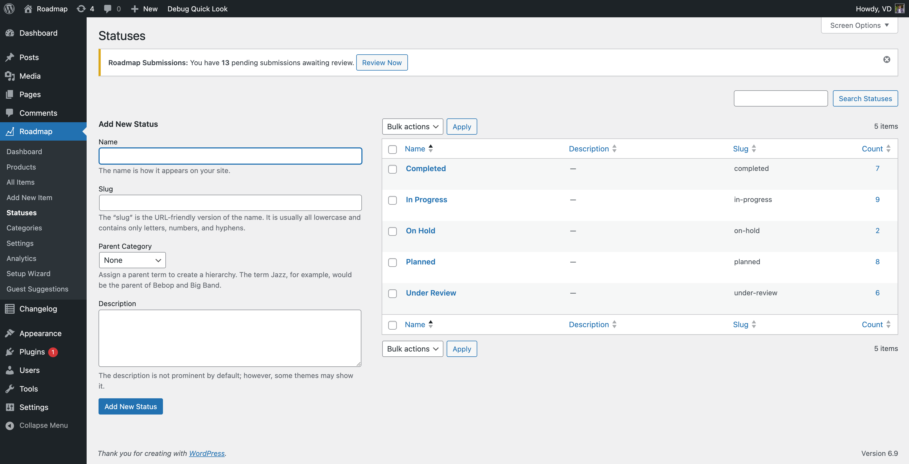
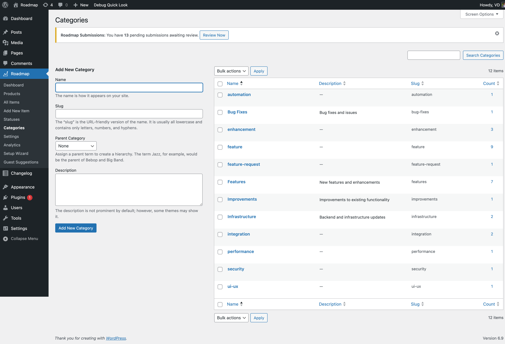

# Statuses and Categories

Statuses and categories are both WordPress taxonomies attached to roadmap items, managed like standard category screens (name, slug, description).

- **Statuses** describe where an item is in your workflow (Planned, In Progress, and so on).
- **Categories** describe what type of item it is (a feature area, a product section, whatever grouping makes sense for you).

Both let you view roadmap items filtered by a specific term.

## Managing statuses



Go to **Roadmap > Statuses**.

Default statuses created on activation:

| Status | Slug |
|---|---|
| Planned | `planned` |
| In Progress | `in-progress` |
| Completed | `completed` |
| On Hold | `on-hold` |
| Under Review | `under-review` |

**Add a status:** enter a **Name** (for example, "Testing"), an optional **Slug**, and an optional **Description**, then click **Add New Status**.

**Edit or delete a status:** click the status name to edit it, or use the row's **Delete** link. Deleting a status leaves items that used it without that term - reassign items to a different status first if you want to keep them organized.

### Giving a custom status a color

The board and item cards color-code statuses through CSS, not through an admin color picker. A status whose slug isn't one of the built-in five renders as a neutral grey chip until you give it a color in your theme's CSS:

```css
.roadmap-status-testing {
    --rm-status: #6b46c1;
    --rm-status-tint: #ede9fe;
}
```

See the [developer guide's theming section](../developer-guide/01-architecture-overview.md#colours-and-theming) for the full token list.

## Managing categories



Go to **Roadmap > Categories**. Categories are hierarchical, so you can nest a category under a parent (for example, "Mobile" under "Platform").

**Add a category:** enter a **Name** (for example, "Integrations"), an optional **Slug**, an optional **Parent**, and an optional **Description**, then click **Add New Category**.

An item can belong to more than one category.

## Using statuses and categories in the shortcode

```
[roadmap status="in-progress"]
[roadmap category="integrations"]
```

Each attribute takes exactly one slug. See the [shortcode reference](../developer-guide/04-shortcode-reference.md) for the full attribute list, including how to combine filters.

## Next steps

- [Managing Roadmap Items](../admin-guide/01-managing-roadmap-items.md)
- [Displaying Your Roadmap](../admin-guide/02-displaying-your-roadmap.md)
